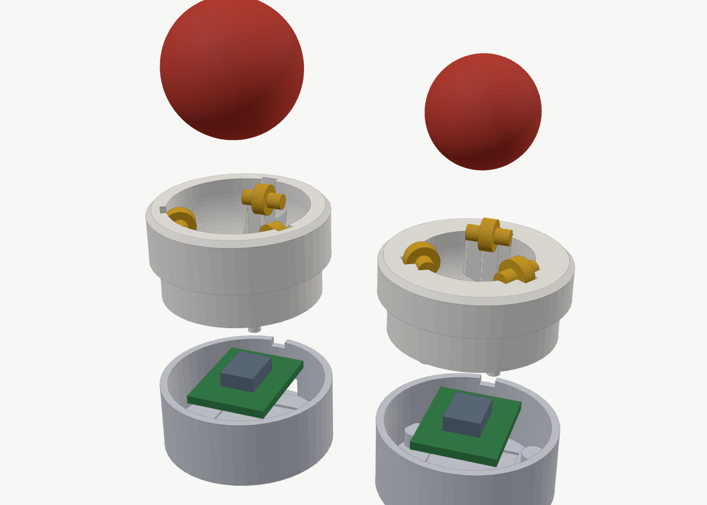
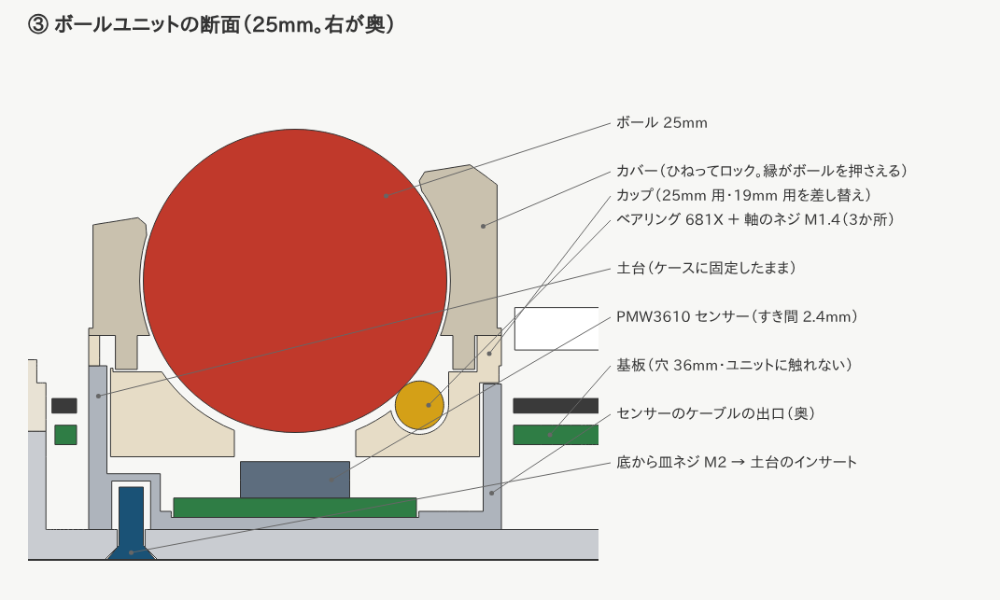
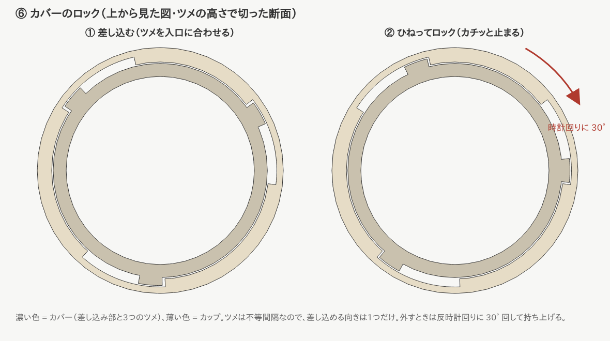
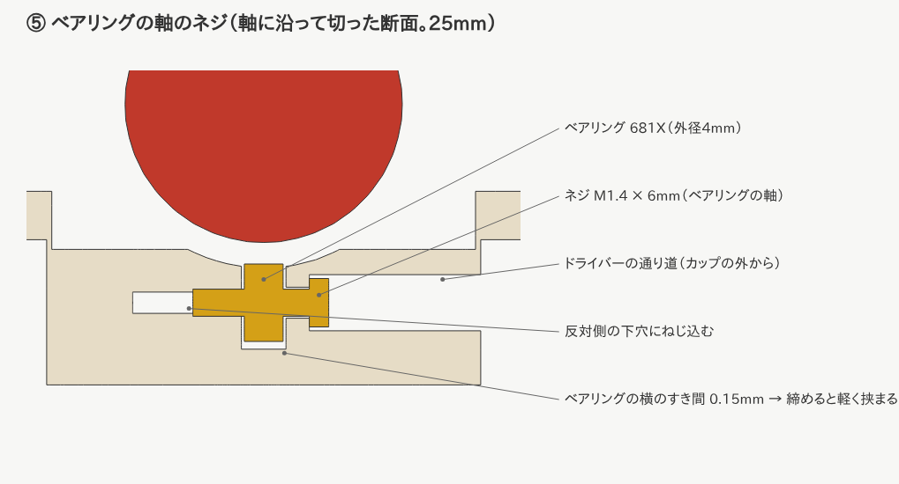
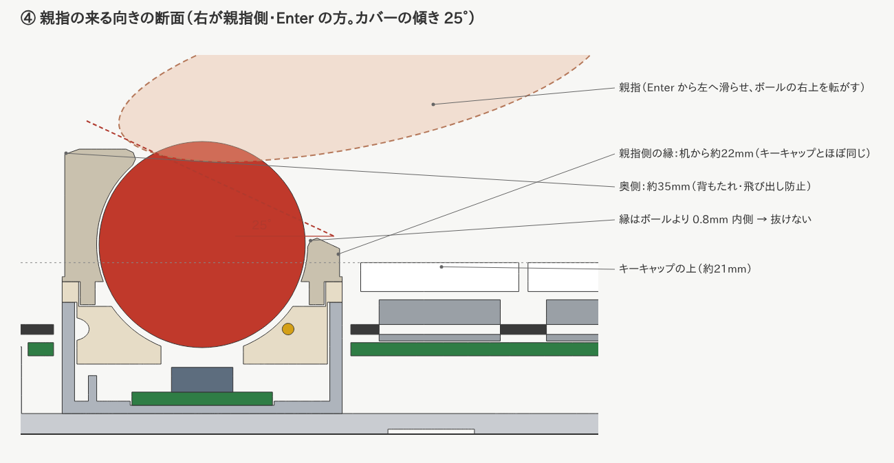
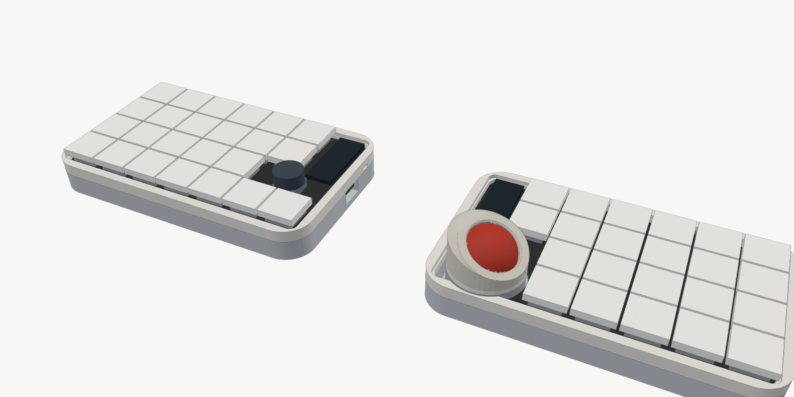
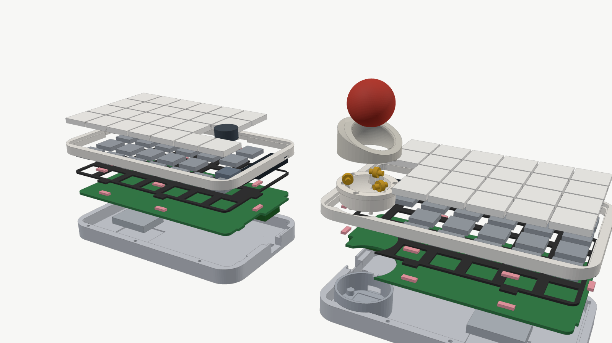
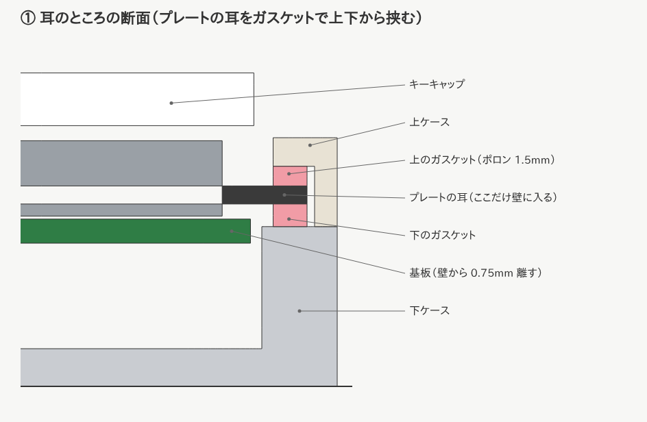
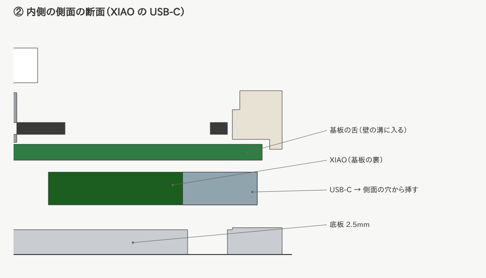

# kataware — 左右無線・トラックボール付き分割キーボード（ZMK 設定）

自作の分割キーボード「kataware」用の ZMK ファームウェア設定です。
基板がまだない段階から使えるように、**「この通りに配線すればこのファームがそのまま動く」**という形で作ってあります。

> この一式は 2026年10月時点の ZMK `main` で、全ファームウェア
> （左手・右手（トラックボール付き）・リセット用）がビルドできることを確認済みです。
> 実物での動作（キー入力・トラックボール）は基板ができてから確認が必要です。

---

## 1. 全体の流れ

自作キーボードは大きく **ハードウェア** と **ファームウェア** の2つに分かれます。

```
[1] 仕様を決める  ← 今ここ（このリポジトリで決めた内容）
[2] 回路図・基板設計（KiCad など）   ← 下の「配線表」に合わせて設計
[3] ケース設計（3Dプリント/アクリル）
[4] 基板・部品の発注、はんだ付け
[5] ファームウェアのビルド・書き込み  ← このリポジトリがそのまま使える
[6] キーマップの調整
```

ファームウェアは「どのピンに何がつながっているか」が決まればほぼ完成します。
**このリポジトリのピン配置に合わせて基板を設計すれば、[5] はすぐ終わります。**

---

> 💡 **製作用の形は「浮島」**です。データ・買う物・3D プリント・組み立ては **[docs/ukishima-build.md](docs/ukishima-build.md)**、考え方と経緯は [docs/concept/](docs/concept/README.md)。
> このページの「ケース（ガスケットマウント）」の節は古い版の説明です。

## 2. 仕様


| 項目 | 内容 |
| --- | --- |
| 配列 | オーソリニア。片手 5列 × 4段 ＋ **1・2段目の内側に1列（T・G の右／Y・H の左）** ＋ 左手4段目の内側に2キー → **合計46キー**（左24・右22） |
| エンコーダー | **左手**の内側。**英数・Raise キーの真上の中央**に置き、3つで三角形の「塊」にする。回す＋押し込みスイッチ付き。薄型推奨 |
| キー間隔 | 19.05mm（MX と同じ） |
| スイッチ | **Kailh Choc v2（ロープロファイル）・ソケット式**。軸が MX 互換なのでキーキャップを選びやすい |
| トラックボール | **右手に固定**。**25mm（標準）と 19mm を付け替えられる**。センサー PMW3610。右手の内側、**[ ] の列の下・N の段**（カバーの奥の端が ] のすぐ下に来る位置） |
| ボールユニット | **土台（ケースに固定・センサー入り）＋交換カップ（25mm / 19mm）**。ベアリング 681X（外径4mm）3個で支える。PMW3610 基板は土台の底に上向きで置く |
| 基板・ケース | **左右別々の基板**（右手を設計して左右反転し、左右の違いを調整。リバーシブルにはしない）。**ケースは左右同じ大きさ・同じ角の丸み**（外形 約143 × 86mm、角の丸み R14mm、縁 5mm） |
| 接続 | 左右とも完全無線（Bluetooth）。PC とは**右手側**がつながる |
| マイコン | **Seeed Studio XIAO nRF52840 Plus** × 2（**技適取得済み**） |
| 画面 | **nice!view** × 2（左右とも。不要な側は付けなくてよい） |
| 電源 | スライド式の電源スイッチ（左右とも）。持ち運び中は OFF にして電池を節約 |
| リセット | キー操作で書き込みモードに入れる＋キーが効かない時は底板の穴から押す |
| 電池 | リチウムポリマー電池（左右に1個ずつ） |

### トラックボールの付け替え（25mm ⇔ 19mm）

| ボール | 付け方 |
| --- | --- |
| **25mm（標準）** | 土台に **25mm 用カップ**を差し込む |
| **19mm** | 同じ土台に **19mm 用カップ**（アダプター）を差し込む |

- **土台**（センサー入り）はケースの底にネジでとめたまま。**カバーとカップを上から抜いて差し替えるだけ**（ネジを外さない）
- 掃除の時は、どちらのサイズも**カバーを外せばボールだけ上から取り出せる**（ふだんはカバーの縁が押さえていて抜けない）
- どちらのカップも**ボールの一番下の高さが同じ**なので、センサーとのすき間（約2.4mm）は変わらない
- 基板側も**共通**（センサー用コネクタ・センサー PMW3610・ファームウェアは同じ）
- ボールの大きさで動く速さが変わるので、ファームウェアの `cpi`（`kataware_trackball.overlay`）で調整する
- 34mm は浮島で専用の受けを用意した（[浮島の作り方](docs/ukishima-build.md)）

### デザインの方針

- **左右を同じ大きさ・同じ角の丸みの長方形**にして、並べたときに1つの道具に見えるようにする
- 内側の帯（キー2つ分の幅＝38.1mm）は左右で対になる：右は「追加キー2つ＋マイコン＋ボール」、左は「追加キー2つ＋マイコン＋エンコーダー＋親指キー2つ」
- **左の「塊」と右のボールが対になる**（名前の「片割れ」）：左はエンコーダー・英数・Raise の3つを三角形にまとめ、
  右のボールと同じ位置・同じ大きさ感にそろえる。ケースでは、左の塊の台座と右のボールケースを
  同じ素材・同じ色の部品にして、左右で1組に見えるようにする（着せ替えパーツにもできる）
- **ケースとプレートは着せ替えできる作り**にする（素材違いのプレートへの交換、色違いケースなど）
- 飾りは足さず、面取り・角の丸み・素材の色で整える
- 外周は **R14mm** の大きめの角丸（これ以上大きくすると角のキーキャップにかかる）

### 打鍵感をケースで良くする（ロープロファイルでも打ち心地を捨てない）

| 工夫 | 効果 | kataware での扱い |
| --- | --- | --- |
| **ガスケットマウント** | プレートをゴムやポロン（柔らかいスポンジ）で上下から挟んで浮かせる。底打ちが柔らかく、音も静かになる | **浮島で採用**：トレイの柱 8 本の上のポロンに基板を乗せ、下から留める（[作り方](docs/ukishima-build.md)） |
| **プレートの素材を選べるようにする** | FR4（標準・ほどよくしなる）／POM（柔らかく静か）／アルミ（硬くカチッとした感触） | プレートを**交換式**にする（着せ替えの考え方） |
| **フォームを入れる** | プレートと基板の間・基板とケース底の間にスポンジを入れ、カチャカチャした響きを抑える | 底側は XIAO と電池の場所を避けて切り抜く |
| **フレックスカット** | プレートに細い切れ込みを入れて、しなりを足す | プレートの図面に後から追加できる |
| **ケースの重さ・剛性** | 底に薄い金属板を入れて重くすると、ずれにくく、響きも締まる | 持ち運びとの兼ね合いで、薄いステンレス板を検討 |
| **ゴム足** | 机の上で滑らない・響きを吸収 | 底板に付ける |

1台目のおすすめ：**FR4 プレート＋ガスケットマウント＋フォーム**。後からプレートだけ POM などに替えて好みを探す。

### ボールの位置

```
 Q    W    E    R    T    -                 [    Y    U    I    O    P
 A    S    D    F    G    '                 ]    H    J    K    L    ;
 Z    X    C    V    B   (◎)          （●）     N    M    ,    .    /
 Sft  Tab  Ctl Lower Spc 英数 Raise               Enter Raise BS  かな Sft
```

- ボール（●）は右手の **[ ] の列の下、N の段の高さ**。左手のエンコーダー（◎）と左右で向かい合う
- カバーの奥の端が **] のキーのすぐ下**（すき間 約1mm）まで来る
- これ以上は動かせない限界の位置にしてある（`pcb/ergogen/config.yaml` の `ball_x` / `ball_y`）

| ぶつかりそうな部品 | すき間 |
| --- | --- |
| ] のキーキャップ（上） | 約1.1mm |
| N・Enter のキーキャップ（右） | 約1.1mm |
| XIAO（基板の裏・左上） | 約0.7mm（XIAO を 1.5mm 上へずらした） |
| nice!view（左上） | 約1.1mm |

- ボールユニットがケースの内側に収まったので、右手のケースの壁のふくらみがなくなり、**左右のケースが同じ形**になった
- センサーのケーブルは、土台の**右側（Enter の方）**から出して、基板の裏の **コネクタ J**（H と J のキーの下あたり。ソケットのあいだの空き）に挿す

### ボールユニット（土台＋交換カップ）




ボールユニットは、**土台**（ケースに固定）・**カップ**・**カバー**（どちらもボールの大きさごとに差し替え）でできています。

> 浮島では、土台をトレイの床に落とし込み（耳を床の裏から 3 本のネジで留める）、カバーは低い「爪留め」になります。34mm は専用の受けです。
> カップ・ベアリング・ネジでの調整はこの節と同じ。違う所は [浮島の作り方](docs/ukishima-build.md) と [構想のページ](docs/concept/README.md)。

| 部品 | 中身 |
| --- | --- |
| 土台 | 外径 34mm・高さ 13.5mm。**ケースの底に裏から皿ネジ M2 × 3本**（土台の柱に熱圧入インサート M2）。底のくぼみに PMW3610 の基板を置く。奥にケーブルの出口と、カップの向きを決める切り欠き |
| カップ（25mm 用 / 19mm 用） | 土台に差し込むだけ。**ベアリング3個**（120°間隔・0° / 120° / 240°。外側に 1 個置くので、キーボードを傾けて（テンティング）も約 45° までボールが浮かない）でボールを下から支える。下の4本の足でセンサー基板を押さえる。奥の「キー」が土台の切り欠きに入り、回らない |
| カバー（25mm 用 / 19mm 用） | **親指で使う向きに 25° 傾けた**押さえ。縁の穴はボールより少し小さい（25mm 用 23.4mm・19mm 用 17.4mm）ので、ふだんはボールが抜けない。**ひねってロックする（バヨネット式）**ので、指が当たっても外れない。外す時は反時計回りに 30° 回すだけ（工具なし） |
| ベアリング | **681X**（内径1.5 × 外径4 × 幅2mm）、3個／カップ。軸は **M1.4 × 6mm のなべタッピングネジ**。**ネジの締め具合で回り方を調整できる**（下の「ボールの回り方の調整」） |
| センサー | PMW3610 の基板（16 × 20mm を想定・**実物合わせ**）。レンズの上面からボールまで **2.4mm** |

- **ガスケットでもボールが動かない理由**：基板とプレートは押すと上下に少し動くが、土台はケースの底にネジでとまっている。
  基板・プレートの穴は直径36mm（ユニット34mm＋まわり1mm）なので、どこにも触れない
- センサーと基板をつなぐケーブルは、少したるませる（基板が動いても引っぱらない）
- 掃除：①カバーを反時計回りに 30° 回して外す ②ボールを取り出す ③ベアリングの表面やカップの中をふく（ベアリングは付けたままで OK） ④ボールをのせ、カバーを差し込んで時計回りに 30° ひねる
- サイズの付け替え：①カバーとボールを外す ②カップをつまんで上に抜く ③もう一方のカップを、奥のキーを合わせて差し込む ④ボールとカバーを付ける
- 高さ（机から）：25mm ボールのてっぺん **約35.5mm**／19mm は **約29.5mm**。カップの上面は 18.5mm（上ケースより 2mm 上）、その上にカバー
- 3D データは `case/stl/ball_base.stl`・`ball_cup_25.stl`・`ball_cup_19.stl`・`ball_cover_25.stl`・`ball_cover_19.stl`。作り直しは `python3 case/ball_unit.py`

#### カバーのロック（ひねって留める）



- カバーの下に**差し込み部（リング）と3つのツメ**、カップの上面に**入口と溝**がある（瓶のふたや、カメラのレンズと同じ考え方）
- 付け方：①カバーを差し込める向きに合わせて上から入れる ②**時計回りに 30° ひねる** → 最後に小さな山を越えて**カチッ**と止まる
  - ツメは**不等間隔**（0°・110°・235°）なので、差し込める向きは1つだけ。ロックすると、カバーの低い側が自動的に親指の方を向く
- 外し方：**反時計回りに 30°** 回して持ち上げる。指でボールを転がしても、カバーを上や横から押しても外れない
- カバーの外側に**すべり止めの溝**（36本）があり、つまんでひねりやすい
- ロックの固さ（カチッの強さ）は `case/ball_unit.py` の `DETENT_H`（小さな山の高さ・0.3mm）で調整できる。
  固すぎる時は 0.2mm、ゆるい時は 0.4mm に

#### ボールの回り方の調整（ネジ式）



- ベアリングは**上からカップの溝に入れ**、カップの**外側の穴から M1.4 × 6mm のネジ**を差して、ベアリングの穴を通し、反対側の下穴にねじ込む
- ベアリングの左右のすき間は 0.15mm と小さくしてあるので、ネジを締めるとネジ頭が壁を押し、**壁がベアリングを軽く挟む**
  - **ゆるめる** → 軽く回るが、ボールがカタカタする（ガタが出る）
  - **締める** → ガタが減り、しっとり回る。締めすぎると重くなる（引っかかる）
- 調整のしかた：
  1. カバーとボールを外し、カップを土台から抜く
  2. 3本のネジを、止まるところまで回してから **1/4 回転ずつゆるめる**
  3. カップを戻してボールをのせ、指で回して確かめる。3か所の重さがそろうように少しずつ合わせる
- 道具：**精密ドライバー（＋ 0番）**。ネジ頭はカップの外側から 約9〜11mm 奥にあるので、軸の長いものを使う
- ⚠️ 樹脂の下穴にねじ込むので、何度も強く締めたりゆるめたりすると穴がゆるくなる。ゆるくなったら、少し長いネジ（M1.4 × 8mm）にするか、カップを印刷し直す

#### 親指で使うためのカバーの角度



- 親指のふだんの位置は右手の **Enter**。そこから左へ滑らせてボールに乗せる。
  そのため、カバーは**親指の来る向き（Enter の方・少し手前）へ 25° 下がる**形にした（`case/ball_unit.py` の `COVER_TILT`・`THUMB_FROM`）
- **親指側の縁は机から約22mm**（25mm）・約21mm（19mm）で、**キーキャップの上（約21mm）とほぼ同じ高さ**。Enter から段差なしでボールに移れる
- 親指側はボールの**赤道のあたりまで見えている**ので、親指の腹で横からも転がせる
- **奥側は約35mm**（25mm）と高く、ボールのてっぺんの少し下まで包む。親指で押し出しても、ボールが奥へ逃げない「背もたれ」になる
- 角度を変えたい時は `COVER_TILT` を変えて作り直す（目安：20°＝ボールが多く見えてなでやすい、30°＝奥の壁が高く押し込みやすい）
- ⚠️ 実際の手の大きさで感じ方が変わるので、カバーだけ角度違いを何個か印刷して試すのがおすすめ（カバーはひねるだけで付け外しできるので交換が簡単）
- 印刷の向き：土台は底を下、カップは**上の縁を下（裏返し）**にする。ネジの下穴やベアリングの溝は樹脂の種類で太さが変わるので、
  まず1つ印刷して確かめる（`case/ball_unit.py` の `SCREW_PILOT_R`・`BRG_SIDE` などで調整）
- ⚠️ センサー基板の大きさ・レンズの高さは買う基板で違う。届いたら測って `SENSOR_W` `SENSOR_L` `LENS_H` を直す

### 基板のイメージ


`python3 tools/draw_pcb.py docs/images` で作り直せる（位置・外形は `pcb/ergogen/config.yaml` と同じ）。

### ケース（浮島・製作用）


低いトレイの柱 8 本の上のポロンに基板（＋プレート）を乗せ、**基板の裏の M2 ナットにトレイの裏からネジで留める**作り。上からネジは見えない。
トレイの裏に MagSafe メタルリングの溝（テンティング用）。データ・買う物・印刷・組み立ては **[docs/ukishima-build.md](docs/ukishima-build.md)**。

### ケース（旧版：ガスケットマウント）

> ⚠️ 古い版の説明です。データは `case/stl/old_gasket/`。浮島でプレートの耳を無くしたので、今のプレートはこのケースに合いません。




**下ケース**（底と壁）と**上ケース**（枠）の2つに分かれ、その間で**プレートの耳を上下からガスケット（ポロン）で挟む**作りです。
基板はプレートにスイッチでぶら下がるので、プレートと基板はいっしょに浮き、どこもケースに触れません。



| 部分 | 決めたこと |
| --- | --- |
| 外形 | 左右同じ 143.35 × 86.2mm、角 R14、壁 5mm |
| ケースの内側 | キーの範囲ちょうど（133.35 × 76.2mm、角 R5）。左右とも同じ形（ボールユニットは内側に収まる） |
| プレート | 内側より 0.5mm 小さい。**耳（幅8mm）6か所**（上2・下2・左右1ずつ）が壁の溝に 3mm 入る |
| ガスケット | 耳の上と下に1枚ずつ（計12枚／片手）。**ポロン 1.5mm 厚**、約 8 × 2.75mm に切る。上は 0.2mm だけつぶれる |
| 基板 | 内側より 0.75mm 小さい（壁に当たらない）。ソケットのパッドが端まで来る列（右手の一番外側・左手の Raise）だけ、細い帯が壁の溝に入る |
| 基板の「舌」 | 内側の側面に、XIAO の USB-C と電源スイッチを出すための舌（幅6mm）。壁の溝に入る |
| 上ケースの開口 | 内側より 0.75mm 大きい（キーキャップと 約1.3mm あく）。角は R3.5 にして角のキーキャップに当てない |
| 上下ケースの固定 | **M2 なべタッピングネジ（長さ12mm）× 6本／片手**。底から入れ、上ケースの下穴（直径1.7mm）にねじ込む |
| 底板 | 厚さ 2.5mm。電池のくぼみ（1mm）、リセット用の穴、ゴム足（直径10mm）のくぼみ 4か所 |
| ボールユニット | 土台を底から**皿ネジ M2 × 3本**でとめる（上の「ボールユニット」） |

#### 高さ（机から）

| 部分 | 高さ |
| --- | --- |
| 底板の上面 | 2.5mm |
| 基板 | 9.5〜11.1mm（下に 7mm：XIAO・電池・ソケットが入る） |
| 下ケースと上ケースの分かれ目 | 10.6mm（下のガスケットが乗る面） |
| プレート | 12.1〜13.3mm（Choc v2：基板の上面からプレートの上面まで 2.2mm） |
| 上ケースの一番上 | 16.5mm |
| キーキャップの上 | 約21mm（キーキャップによる） |
| ボールのてっぺん | 約35.5mm（25mm）／約29.5mm（19mm） |



#### 作り方・3D プリントの向き

- 3D データ（STL）は `case/stl/old_gasket/`。作り直しは `python3 case/kataware_case.py`（先に Ergogen を実行しておく）
  - 平面の形はすべて Ergogen の DXF から読み込むので、`config.yaml` を変えればケースも追従する
  - 高さやネジ・穴の位置は `case/kataware_case.py` の上の方にまとめてある
  - ボールユニットは `python3 case/ball_unit.py`
- 下ケースは**底を下**に、上ケースは**上面を下（裏返し）**にして印刷すると、サポート材がほぼ要らない
- 注文するなら JLC3DP などの樹脂（レジン）印刷。自分で印刷するなら PLA / PETG で OK
- 組み立て順：下ケース → 下のガスケット → プレート＋基板（スイッチを挿した状態）→ 上のガスケット → 上ケース → 底からネジ
- ⚠️ 寸法は部品の実物合わせが必要な所がある（XIAO のリセットボタンの位置、電源スイッチのレバーの位置、ボールユニット）。
  まず1つ印刷して、実物を入れて確かめる

### なぜこの部品なのか

- **Seeed Studio XIAO nRF52840 Plus**
  - **技適取得済み**（国内販売店のページに認証番号の記載あり）。日本で無線を使うための条件を満たす
  - Bluetooth・電池充電回路を内蔵。ZMK に標準対応（ボード名 `xiao_ble`）。自作キーボードでの使用例も多い
  - 普通の XIAO（11本）より **ピンが多く**、kataware の部品（キー・エンコーダー・トラックボール・画面）を追加部品なしでつなげる
  - 小さい（約 21 × 17.8mm）
  - ⚠️ 普通の XIAO nRF52840 とは**別の製品**。購入時は型番と技適の表示を必ず確認する
- **nice!view（画面）**
  - 電波を出さない表示部品なので技適は関係ない
  - 光らないメモリ液晶で、**消費電力がごくわずか**。無線キーボード向け
  - 右手（PC とつながる側）：Bluetooth の接続先・電池残量・**今のレイヤー**を表示。左手：電池残量・接続状態を表示
- **PMW3610 センサー**
  - 低消費電力で、無線トラックボールの自作でよく使われる定番
  - 単体ではなく「PMW3610 ブレイクアウト基板（センサー＋レンズ付きの小基板）」を買うと簡単です
- **ボールは 25mm**
  - 34mm（大きいトラックボール）より小さく、持ち運び向き。19mm・34mm にも付け替えられる
- **ボールのある右手を PC とつながる側（セントラル）にする理由**
  - センサーのデータを左右間の無線で中継しなくてよいので、遅延が少なく設定も簡単
  - デメリット：右手の電池の減りが早くなる（右手だけ容量の大きい電池にすると◎）

### 技適について

- 無線で使うので、**技適取得済みのマイコン（XIAO nRF52840 Plus）**を使う
- 購入前に、総務省「技術基準適合証明等を受けた機器の検索」で型番と認証番号を確認する
- 電波の強さを上げる設定（`CONFIG_BT_CTLR_TX_PWR_PLUS_8` など）は**使わない**（認証の範囲を超えないように）

### 配列について

キーは全部 19.05mm の格子に**一直線に揃えて**並べます（ずれると押しにくくなるため）。
キーの見た目の位置は `boards/shields/kataware/kataware-layout.dtsi` で決めています。

---

### 実寸テンプレート（印刷して手を置いて確かめる）

[`docs/template/kataware-template.pdf`](docs/template/kataware-template.pdf)（A4 横・左手と右手で2ページ）

- 印刷するときは **「実際のサイズ（100%）」** を選ぶ（「ページに合わせる」はNG）
- 左下の線が **50mm ちょうど** か定規で確かめてから使う
- 外形・キーキャップ（18mm 角の目安）・ボール（25mm）と受け皿（約34mm）・エンコーダーのつまみ（15mm）・nice!view（36 × 14mm）・XIAO（21 × 17.8mm、裏側）の位置が実寸で入っている
- 作り直すとき：`python3 tools/make_template.py docs/template` で HTML を作り、ブラウザで PDF に印刷する

---

## 3. 配線表（基板設計のときに使う一番大事な表）

マイコンは **XIAO nRF52840 Plus**。`D0` などは XIAO の端子名です。
（ ）内は nRF52840 本来のピン名で、ファームウェアの中ではこちらを使っている所もあります。

### 使えるピンと使わないピン

| 端子 | 使う？ | 備考 |
| --- | --- | --- |
| D0〜D10 | ◯ | 表側の端子 |
| D11 (P0.15) / D12 (P0.19) / D13 (P1.01) | ◯ | Plus で増えた端子（裏側） |
| D17 (P1.07) / D18 (P1.05) / D19 (P1.03) | ◯ | Plus で増えた端子（裏側） |
| D14 (P0.09) / D15 (P0.10) | ✕ | NFC 用。保護部品がなく GPIO には不向き |
| D16 (P0.31) | ✕ | 電池電圧の測定に使われている |

> 公式のピン配置図には誤りがあると報告されています。上の表は Seeed 公式の
> ボード定義ファイル（BSP）と、実機での動作確認報告に合わせてあります。

### キーマトリックス

ダイオードの向き：**列(COL) → 行(ROW)**（`col2row`）
つまり、各スイッチの後ろにダイオードを付け、ダイオードの線（カソード）が **ROW 側** を向きます。

| 信号 | ピン | 左手 | 右手 |
| --- | --- | --- | --- |
| ROW0 | D0 | 1段目 | 1段目 |
| ROW1 | D1 | 2段目 | 2段目 |
| ROW2 | D2 | 3段目 | 3段目 |
| ROW3 | D3 | 4段目 | 4段目 |
| 列1 | D4 | 一番外側（Q の列） | 一番内側（Y・H の左の追加キーだけ） |
| 列2 | D5 | W の列 | Y の列 |
| 列3 | D6 | E の列 | U の列 |
| 列4 | D7 | R の列 | I の列 |
| 列5 | D8 | T の列 | O の列 |
| 列6 | D9 | T・G の右の追加キー、エンコーダー押し込み、英数 | P の列（一番外側） |
| 列7 | D10 | 一番内側：親指の段の Raise だけ | （トラックボールに使用） |

- 左手：5列 × 4段 ＋ T・G の右 ＋ 4段目の内側に2キー ＝ 24キー ＋ エンコーダー押し込み（D9 の列 × ROW2）
- 右手：5列 × 4段 ＋ Y・H の左 ＝ 22キー

### ロータリーエンコーダー（左手のみ）

| エンコーダー側 | XIAO 側 | 備考 |
| --- | --- | --- |
| A | D11 (P0.15) | |
| B | D12 (P0.19) | |
| C（共通） | GND | |
| 押し込みスイッチ | ROW2 × D9 の列 | 普通のキーと同じくダイオードを付けてマトリックスにつなぐ |

### トラックボールセンサー PMW3610（右手のみ）

| センサー側 | XIAO 側 | 備考 |
| --- | --- | --- |
| VDD / VIN | 3V3 | ブレイクアウト基板の表記に合わせる |
| GND | GND | |
| SCLK | D10 (P1.15) | |
| SDIO | D13 (P1.01) | データの送受信を1本で行う |
| NCS (CS) | D11 (P0.15) | |
| MOTION | D12 (P0.19) | 動いた時に知らせる割り込み線 |

### nice!view（画面、左右とも同じ）

| nice!view 側 | XIAO 側 |
| --- | --- |
| MOSI（DI） | D17 (P1.07) |
| SCK | D19 (P1.03) |
| CS | D18 (P1.05) |
| VCC | 3V3 |
| GND | GND |

画面を付けない側は、`build.yaml` のその側の `shield:` から `nice_view` を消してください。

### 電源まわり（左右共通）

```
電池＋ ──[スライドスイッチ]── XIAO 裏面の BAT+
電池− ─────────────────── XIAO 裏面の BAT−
```

- **スライドスイッチ**は電池の＋側に入れる。OFF にすると電池が完全に切り離されるので、持ち運び中の消費はほぼゼロになる
- 部品は **水平（横向き）スライドスイッチ Alps SSSS811101**（キーボード用として Typeractive・LCSC などで販売。
  ソケットより背が低い表面実装品）。基板の端に付けて、つまみをケースの側面から出す
  - 同じ形の MSK12C02 でも動作は同じだが、検証済みの部品データがある SSSS811101 にそろえる
  - トグルスイッチはレバーが飛び出してカバンの中で勝手に入りやすく、同じ大きさの物もないので使わない
- ⚠️ この配線だと**スイッチが OFF のときは充電されない**。充電するときは ON にして USB をつなぐ
- スイッチはケースの側面から指で操作できる位置に置く。ON/OFF が見て分かるようにつまみの色を変えると◎

### マイコンまわりの配置

（位置は「基板のイメージ」の図を参照）

- 左右とも、内側の帯（キー1個分の幅）にまとめる
- **XIAO は基板の裏側**に**横向き**で付け、**nice!view は表側**に重ねる（表から画面、裏にマイコン）
  - 画面はプレートの窓から見える（上ケースは枠だけなので、画面の上に板はない）
  - XIAO Plus の追加ピン（D11〜D19）は裏面のパッドなので、基板側にパッドを用意してはんだ付けする
- **USB-C** は**内側の側面**（左右が向かい合う面）に出す。基板の「舌」が壁の溝に入り、側面の穴から挿す
  - ケースの角は丸い（R14）ので、奥の角に XIAO を置くと角からはみ出す。そのため横向きにして側面の真ん中寄りに置いた
- **電源スライドスイッチ**も内側の側面の、USB-C の奥側に付ける。レバーは側面の細い穴から爪やペン先で動かす
- **リセットボタン**は XIAO を裏付けすると下向きになるので、**底板の穴から細い棒・ピンで押す**
  （ふだんはキー操作で書き込みモードに入るので、使うのはキーが効かない時だけ）
- 部品の寸法：XIAO nRF52840 Plus は 21 × 17.8mm・厚さ約5mm、nice!view は 36 × 14 × 2.9mm
  - nice!view は縦向きでマイコン用スペース（19.05 × 38.1mm）にぎりぎり収まる（長さ方向の余裕は片側約1mm）
  - 基板の下（XIAO と電池が入る空間）は **7mm**（電池は底板の 1mm のくぼみに入れる）

### リセット（書き込みモードに入る方法）

XIAO のリセットボタンはマイコンの上に付いた小さいボタンなので、ケースに入れると押しにくくなります。
kataware では次の2つを用意します。

1. **キー操作で書き込みモードに入る（ふだんはこちら）**
   - Raise を押しながら、左手なら **T の右のキー**、右手なら **Y の左のキー** → その側が書き込みモードになる
   - Raise を押しながら、その下のキー（G の右 / H の左）→ 再起動
2. **底板の穴から押す（ファームウェアが壊れた時など、キーが効かない時用）**
   - XIAO を基板の裏に付けるので、リセットボタンは下向きになる
   - 底板のボタンの真下に小さな穴をあけ、細い棒やピンで押す。**素早く2回押す**と書き込みモード
   - 押し棒を底板に仕込んでおけば、指で押せるようにもできる
   - マイコンの位置と穴を合わせるので、基板設計の時にボタンの位置を正確に決める

### 電池（リチウムポリマー）の選び方

**方針：販売する・しないに関わらず、PSE マーク付きで、届出事業者名が表示された国内流通品を指定する。**

| 条件 | 内容 |
| --- | --- |
| PSE マーク＋届出事業者名 | 表示があるもの（ジイエクサ Gexa の PSE 認証済みリポを候補にする） |
| 保護回路 | 過充電・過放電・過電流の保護回路付き |
| 厚さ | **5mm 以下**（底板の 1mm のくぼみ＋基板の下のすき間 7mm に入れるため。ソケットとの間に約1mm 残す） |
| 容量 | 左右とも 250mAh（GA-011） |
| コネクタ | 電池側に合わせる（Gexa は 1.25mm ピッチ・PicoBlade 互換と思われる） |

**採用：左右とも ジイエクサ Gexa GA-011（軽さ優先）**

| 項目 | 内容 |
| --- | --- |
| 型番 | Gexa GA-011（PSE 認証済み・保護回路内蔵） |
| 容量 | 250mAh |
| 大きさ | 約 20 × 30 × 5mm（幅 × 長さ × 厚さ） |
| 重さ | 約 6g |
| コネクタ | 1.25mm ピッチ 2ピン（白・ロック爪なし → **Molex PicoBlade 互換と思われる**）。**端子面から見て 左＝黒（−）／右＝赤（＋）** |

- 左右同じ電池にして、仕入れを1種類にする。左右の重さもそろう
- 持ち時間の目安：右手（PC とつながる側＋トラックボール）より左手の方が長持ち（実物で要測定）
- もっと長持ちさせたい時の予備案：GA-012（500mAh・約 30 × 48 × 4mm・約 12g）。同じコネクタなので基板はそのまま使える
- キーの下の空いたスペースに置く（XIAO の真下とボールの穴は避ける）
- 基板側は **Molex PicoBlade 2ピン（横から挿すタイプ・`53261-0271`）**（パッド1＝−、パッド2＝＋）。差し込み口は電池のある方を向く
- ⚠️ 実物の電池を挿して**テスターで＋/−を確認**してから XIAO につなぐ（逆だと XIAO が壊れる）。
  逆だった時は `pcb/ergogen/config.yaml` の電池の `pos` / `neg` を入れ替えて作り直す

- PSE の対象は「体積エネルギー密度 400Wh/L 以上」のリチウムイオン電池。とても小さい電池は対象外で、
  PSE マークが付いていないこともある。kataware では**安全を優先して PSE マーク付きの物だけ**を使う
- **販売する時**：PSE マークと届出事業者名の表示がある電池を、国内の正規の販売元から仕入れて同梱する。
  電池だけの販売・同梱の可否や、配送（リチウム電池の発送条件）は、販売前に経済産業省の FAQ と配送業者の規約で確認する
- コネクタの＋と−は**メーカーによって逆**のことがある。基板に＋/−を印刷し、接続前にテスターで確認する
- 充電は XIAO に USB をつなげば自動で行われる（電源スイッチは ON にしておく）

---

## 3.5 基板の設計（Ergogen で作った下書き）

`pcb/ergogen/` に、キーの位置・外形・穴・部品の置き場所をまとめた **Ergogen の設定**があります。
ここから基板（KiCad 用）とプレート（ケース・板の図面）の下書きを自動で作れます。


### 作り直し方

```
npx ergogen@4.1.0 pcb/ergogen -o pcb/ergogen/output
```

### できるもの（`pcb/ergogen/output/`）

| ファイル | 中身 |
| --- | --- |
| `pcbs/left.kicad_pcb` / `pcbs/right.kicad_pcb` | 基板の下書き。KiCad で開いて配線する |
| `outlines/plate_left.dxf` / `plate_right.dxf` | Choc v2 用プレート（スイッチを固定する板・穴 13.8mm 角）の図面。浮島用（耳・ネジ穴なし） |
| `outlines/pcb_*.dxf` | 基板の外形（右手はボールの穴あり） |
| `outlines/board_*.dxf` | ケースの外形（左右同じ 143.35 × 86.2mm、角 R14） |
| `outlines/cavity_*.dxf` / `top_opening_*.dxf` | ケースの内側・（旧版の）上ケースの開口（ケースの 3D データが読み込む） |

### スイッチは Choc に絞った理由


MX と Choc のソケットを同じキーに置くと、**穴どうし・穴とはんだパッドが重なる**ため、
1枚の基板に両方は載せられません。持ち運び重視なので **Choc（ロープロファイル）に絞りました**。
スイッチは **Choc v2** に決定。Choc v2 は中心の足が太いので、基板の中心の穴は **5.0mm** です
（Choc v1 は挿せません）。

### 部品は本物のデータに置き換え済み

| 部品 | フットプリント（KiCad のライブラリ名） | 元データ |
| --- | --- | --- |
| XIAO nRF52840 Plus（基板の裏・横向き） | `Seeed_Studio_XIAO_Series:XIAO-nRF52840-Plus-SMD` | Seeed Studio 公式（[OPL_Kicad_Library](https://github.com/Seeed-Studio/OPL_Kicad_Library)） |
| 電源スイッチ（Alps SSSS811101 / C&K PCM12） | `Button_Switch_SMD:SW_SPDT_PCM12` | KiCad 標準ライブラリ |
| センサー用コネクタ J（右手の裏） | `Connector_JST:JST_SH_BM06B-SRSS-TB_1x06-1MP_P1.00mm_Vertical` | KiCad 標準ライブラリ |
| 電池コネクタ（基板の裏） | `Connector_Molex:Molex_PicoBlade_53261-0271_1x02-1MP_P1.25mm_Horizontal` | KiCad 標準ライブラリ |
| M2 はんだ付けナット（基板の裏・8 か所） | `kataware:SMT_Nut_M2`（パッド φ5・めっき穴 φ2.4） | kataware 用に作成。買う品番に合わせてパッドを調整 |

- 元の `.kicad_mod` は `pcb/ergogen/lib_src/`、Ergogen 用に変換したものは `pcb/ergogen/footprints/lib/`
  （変換は `python3 tools/import_footprints.py`）
- 各ピンのつながり（ネット）は、ファームウェアのピン割り当てどおりに入っている
- **XIAO の電池パッド（BAT+）は XIAO の真下に隠れる**ので、基板のその位置に小さな穴（直径0.7mm）をあけてある。
  XIAO をはんだ付けした後、**基板の表側からこの穴にはんだを流し込む**（nice!view を付ける前に）
- 簡単な検査：`python3 tools/check_pcb.py`（パッドどうしの近さ・基板の端からの距離・裏の部品の重なり・電池の上の部品）。KiCad の DRC も必ず行う

### 部品データとライセンス（販売するため）

| フォルダ | 中身 | ライセンス |
| --- | --- | --- |
| `pcb/ergogen/footprints/kataware/` | Choc v2 スイッチ・nice!view・M2 はんだ付けナット | kataware 用に作成。Choc v2 は Ergogen 内蔵（MIT）をもとにしたもの |
| `pcb/ergogen/footprints/lib/`（元は `lib_src/`） | 電源スイッチ・JST SH コネクタ・PicoBlade コネクタ | KiCad 標準ライブラリ（CC-BY-SA 4.0。**作った基板には適用されない例外つき**なので販売できる） |
| 同上 | XIAO nRF52840 Plus | Seeed Studio OPL_Kicad_Library（CC-BY-SA 4.0。商用利用可・**出典の表示が必要**）。データを配る時はこの表の表示を残す |
| `pcb/ergogen/footprints/ceoloide/` | エンコーダー | MIT（[ceoloide/ergogen-footprints](https://github.com/ceoloide/ergogen-footprints)） |
| Ergogen 内蔵 | ダイオード | MIT |

**非営利ライセンス（CC-BY-NC-SA）の部品は使っていない**ので、この基板は販売できる形になっている。
KiCad で追加する部品も、KiCad 標準ライブラリ（設計に使った基板は自由に販売できる）か、
販売可能なライセンスのものを選ぶこと
- **配線（パターン）はまだ**。部品どうしのつながり（ネット）は入っているので、KiCad で線を引く
- トラックボールセンサーへの接続は、基板の裏の **6ピンコネクタ J**（JST SH・1.0mm ピッチ・上から挿すタイプ。H と J のキーの下あたり）。並びは 3V3 / GND / SCLK / SDIO / NCS / MOTION
- 各キーのダイオードは、スイッチの位置決め穴をよけるため、キーの中心から右へ 2mm ずらしてある

**KiCad での仕上げ方は [docs/kicad-guide.md](docs/kicad-guide.md) に手順をまとめています。**

## 4. ファイルの構成と役割

```
zisaku/
├── .github/workflows/build.yml       … GitHub が自動でビルドするための設定
├── build.yaml                        … 何をビルドするか（左・右・リセット）
├── zephyr/module.yml                 … boards/ フォルダを読み込ませるための設定
├── pcb/ergogen/                      … 基板・プレートの下書き（Ergogen）
│   ├── config.yaml                   … キーの位置・外形・部品の置き場所
│   ├── footprints/                   … 追加の部品（ceoloide の部品・置き場所の枠・センサー用コネクタ）
│   └── output/                       … 生成された基板（KiCad）・図面（DXF）
├── case/                             … ケース
│   ├── ukishima.py                   … ★浮島（製作用）の 3D データを作るプログラム
│   ├── concept_ukishima.py           … 浮島の形（寸法）と、イメージ画像用の 3D モデル
│   ├── ball_unit.py                  … ボールユニットの形の元（土台・25mm/19mm カップ）
│   ├── kataware_case.py              … 旧版（ガスケットケース）
│   └── stl/ukishima/                 … 浮島の STL（トレイ・ボールユニット）。旧版は stl/old_gasket/
├── config/
│   ├── west.yml                      … ZMK本体とトラックボールドライバの取得元
│   ├── kataware.keymap               … ★キー配置（一番よく編集するファイル）
│   └── kataware.conf                 … ★スリープ時間などの設定
└── boards/shields/kataware/          … キーボードの「ハードウェア定義」
    ├── Kconfig.shield                … シールド名の登録
    ├── Kconfig.defconfig             … 右手がセントラル、分割、トラックボール有効 など
    ├── kataware.dtsi                 … 左右共通：マトリックス、行ピン
    ├── kataware_left.overlay         … 左手：列ピン、エンコーダー有効化
    ├── kataware_left.conf            … 左手：エンコーダーの設定
    ├── kataware_right.overlay        … 右手：列ピン
    ├── kataware_trackball.overlay    … トラックボール（右手と一緒にビルド）
    ├── kataware-layout.dtsi          … キーの見た目上の位置
    └── kataware.zmk.yml              … キーボードの説明情報
```

普段さわるのは **★の2つ** だけです。
`boards/` 以下は基板の配線を変えたときだけ編集します。

---

## 5. ファームウェアの作り方（GitHub Actions）

1. このリポジトリのファイルを編集して push する
2. GitHub のリポジトリ画面で **Actions** タブを開く
3. 数分待ってビルドが ✅ になったら、そのビルドを開いて下の方の
   **Artifacts** から `firmware` をダウンロード
4. zip を解凍すると次の3つが入っています

| ファイル | 書き込む場所 |
| --- | --- |
| `kataware_left.uf2` | 左手 |
| `kataware_right-trackball.uf2` | 右手（トラックボール付き） |
| `settings_reset.uf2` | 設定リセット用（左右共通） |

---

## 6. 書き込み方法

1. キーボードを USB で PC につなぐ
2. **書き込みモードにする**：Raise ＋ 内側の追加キー（左は T の右、右は Y の左）を押す。
   キーが効かない時は底板の穴からリセットボタンを**素早く2回押す** → PC に `XIAO-SENSE` などのドライブが現れる
3. 「5. ファームウェアの作り方」の表どおりの `.uf2` をそのドライブにドラッグ＆ドロップ
4. 自動で再起動したら完了。反対側も同じように書き込む
5. PC の Bluetooth 設定で **「kataware」** を探してペアリング

### 左右がつながらない時

1. 左右両方に `settings_reset…uf2` を書き込む
2. 左右両方に、もう一度それぞれのファームを書き込む
3. 左右両方の電源を一度 OFF → ON にする（または底板の穴からリセットボタンを押す）
4. PC 側の Bluetooth 登録も一度削除してから、再ペアリング

---

## 7. 初期キーマップ

```
 Q    W    E    R     T     -                    [     Y     U     I    O    P
 A    S    D    F     G     '                    ]     H     J     K    L    ;
 Z    X    C    V     B    (◎)              ●          N     M     ,    .    /
 Sft  Tab  Ctl  Lower Space 英数 Raise                 Enter Raise BS   かな  Sft
```

- **Ctl**：タップで Esc、長押しで Ctrl
- **英数**：タップで 英数、長押しで GUI（Windows キー / Mac の Command）
- **かな**：タップで かな、長押しで Alt（Mac の Option）
- **◎ エンコーダー**：回すと音量（Lower 中はページ送り、Raise 中は画面の明るさ）、押すとミュート

| レイヤー | 入り方 | 内容 |
| --- | --- | --- |
| 0 Base | 通常 | QWERTY |
| 1 Lower | 左の Lower を押している間 | 数字、矢印、Home/End/PageUp/PageDown、Delete、` と ' |
| 2 Raise | 左右どちらかの Raise を押している間 | 記号、F1〜F12、Bluetooth 切替 |
| 3 Mouse | **ボールを動かすと自動で ON**（約0.7秒で OFF） | 右手 J/K/L、左手 F/D/S がクリック |
| 4 Scroll | Mouse 中に `;`（右）か `A`（左）を押している間 | ボールでスクロール |

- Bluetooth は Raise レイヤーの 2段目左から「接続先0〜4」、4段目の左内側が「接続先の削除」です。
  スマホ・PC など最大5台を切り替えられます。
- 英数/かなは Mac では確実に動作、Windows は IME の設定次第です。

---

## 8. よくあるカスタマイズ

### キーの割り当てを変える
`config/kataware.keymap` の `&kp Q` などを書き換えます。
キーの名前一覧：https://zmk.dev/docs/keymaps/list-of-keycodes

### カーソルの速さを変える
`boards/shields/kataware/kataware_trackball.overlay` の `cpi = <600>;` を変更（200〜3200、200刻み）。
大きいほど速くなります。

### カーソルの向きがおかしい
同じファイルの `// swap-xy;` `// invert-x;` `// invert-y;` の `//` を外して調整します。
センサーをケースにどの向きで付けたかで変わるので、実物で試しながら決めます。

### スクロールの向きが逆
`config/kataware.keymap` の `scroller` の部分を次のように変えます。
```
input-processors = <&zip_xy_to_scroll_mapper &zip_scroll_transform INPUT_TRANSFORM_Y_INVERT &zip_scroll_scaler 1 8>;
```
（ファイル先頭に `#include <dt-bindings/zmk/input_transform.h>` も追加）

### キーボードの名前を変える
`kataware` という文字をすべて新しい名前に置き換え、ファイル名の `kataware` も同じように変えます。
Bluetooth に表示される名前は `Kconfig.defconfig` の `ZMK_KEYBOARD_NAME` です（16文字以内）。

### キーの数を増やす・減らす
次の3か所の数を揃える必要があります。
1. `kataware.dtsi` の `default_transform` の `map`（どのスイッチがどの位置か）
2. `kataware-layout.dtsi` の `keys`（見た目の位置）
3. `kataware.keymap` の各レイヤーの `bindings`（割り当て）


---

## 9. 次にやること（ハードウェア）

1. **部品を決めて買う**（浮島のケースで増える物：ナット・カラー・ネジ・ポロン・メタルリングなどは [浮島の作り方](docs/ukishima-build.md#4-買う物浮島で増える物)）：XIAO nRF52840 Plus ×2、PMW3610 ブレイクアウト、25mm ボール、
   ボール支持用ベアリング 681X（1.5 × 4 × 2mm）＋ 軸用 M1.4 × 6mm なべタッピングネジ ×3組（19mm カップも作るなら ×6組）、nice!view ×2、水平スライドスイッチ Alps SSSS811101 ×2、ロータリーエンコーダー（押し込み付き・薄型）×1、Kailh Choc v2 スイッチ ×46、Choc 用ホットスワップソケット ×46、ダイオード 1N4148W（SOD-123・表面実装・基板の裏）×47、PSE 認証済みリポ電池 Gexa GA-011 ×2、1.25mm ピッチ 2ピンコネクタ ×2
2. **キー配置を決める**：[Keyboard Layout Editor](http://www.keyboard-layout-editor.com/) や
   [Ergogen](https://ergogen.xyz/) で配置を決める（Ergogen は配置から基板の下書きまで作れます）
3. **基板設計**：[KiCad](https://www.kicad.org/) で回路図 → 基板。上の配線表どおりにつなぐ
4. **ケース・ボールケース設計**：トラックボールのセンサーとボールの距離（PMW3610 は約2.4mm）が重要
5. **組み立て後**、まずキーだけ → 次にトラックボール、と1つずつ動作確認

---

## 参考

- ZMK 公式ドキュメント：https://zmk.dev/docs
- 新しいキーボードの追加方法：https://zmk.dev/docs/development/hardware-integration/new-shield
- ポインティングデバイス：https://zmk.dev/docs/features/pointing
- PMW3610 ドライバ：https://github.com/badjeff/zmk-pmw3610-driver
