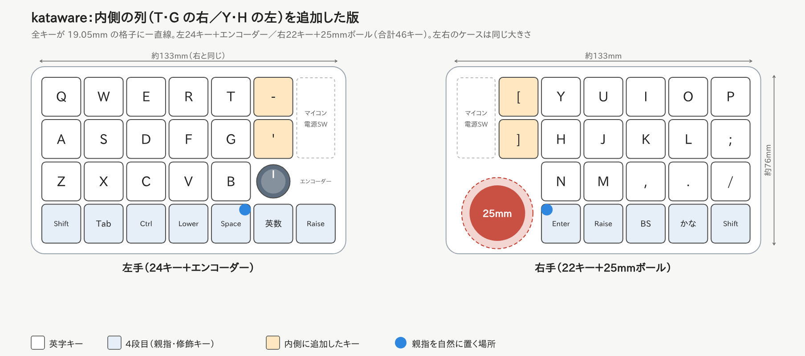
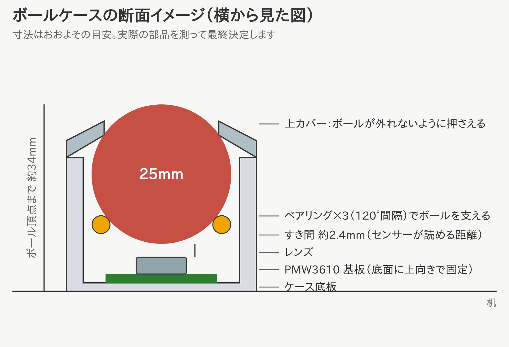
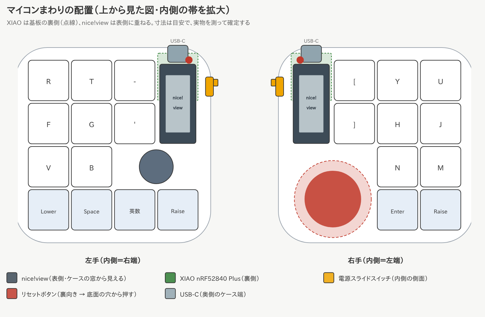
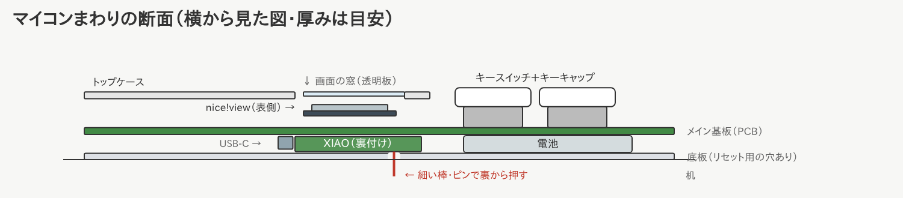
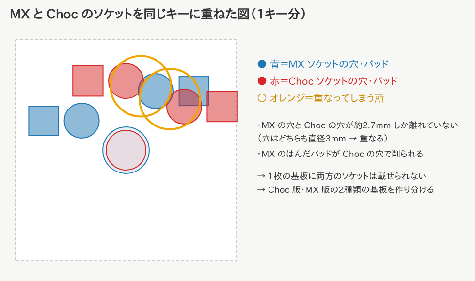

# kataware — 左右無線・トラックボール付き分割キーボード（ZMK 設定）

自作の分割キーボード「kataware」用の ZMK ファームウェア設定です。
基板がまだない段階から使えるように、**「この通りに配線すればこのファームがそのまま動く」**という形で作ってあります。

> この一式は 2026年10月時点の ZMK `main` で、全ファームウェア
> （左手・右手（トラックボール付き）・リセット用）がビルドできることを確認済みです。
> 実物での動作（キー入力・トラックボール）は基板ができてから確認が必要です。

---

## 1. 全体の流れ

自作キーボードは大きく **ハードウェア** と **ファームウェア** の2つに分かれます。

```
[1] 仕様を決める  ← 今ここ（このリポジトリで決めた内容）
[2] 回路図・基板設計（KiCad など）   ← 下の「配線表」に合わせて設計
[3] ケース設計（3Dプリント/アクリル）
[4] 基板・部品の発注、はんだ付け
[5] ファームウェアのビルド・書き込み  ← このリポジトリがそのまま使える
[6] キーマップの調整
```

ファームウェアは「どのピンに何がつながっているか」が決まればほぼ完成します。
**このリポジトリのピン配置に合わせて基板を設計すれば、[5] はすぐ終わります。**

---

## 2. 仕様



| 項目 | 内容 |
| --- | --- |
| 配列 | オーソリニア。片手 5列 × 4段 ＋ **1・2段目の内側に1列（T・G の右／Y・H の左）** ＋ 左手4段目の内側に2キー → **合計46キー**（左24・右22） |
| エンコーダー | **左手**の内側。**英数・Raise キーの真上の中央**に置き、3つで三角形の「塊」にする。回す＋押し込みスイッチ付き。薄型推奨 |
| キー間隔 | 19.05mm（MX と同じ） |
| スイッチ | **Kailh Choc v2（ロープロファイル）・ソケット式**。軸が MX 互換なのでキーキャップを選びやすい |
| トラックボール | **右手に固定**。25mm ボール、センサー PMW3610。右手の内側、4段目の高さ（FrostOrtho と同じ考え方） |
| ボールケース | 専用ケース。**ベアリング3個で支える方式**、PMW3610 基板は**ケースの底面**に上向きで置く |
| 基板・ケース | **左右別々の基板**（右手を設計して左右反転し、左右の違いを調整。リバーシブルにはしない）。**ケースは左右同じ大きさ・同じ角の丸み**（外形 約143 × 86mm、角の丸み R14mm、縁 5mm） |
| 接続 | 左右とも完全無線（Bluetooth）。PC とは**右手側**がつながる |
| マイコン | **Seeed Studio XIAO nRF52840 Plus** × 2（**技適取得済み**） |
| 画面 | **nice!view** × 2（左右とも。不要な側は付けなくてよい） |
| 電源 | スライド式の電源スイッチ（左右とも）。持ち運び中は OFF にして電池を節約 |
| リセット | キー操作で書き込みモードに入れる＋キーが効かない時は底板の穴から押す |
| 電池 | リチウムポリマー電池（左右に1個ずつ） |

### デザインの方針（DRESSTHING を参考に）

- **左右を同じ大きさ・同じ角の丸みの長方形**にして、並べたときに1つの道具に見えるようにする
- 内側の帯（キー2つ分の幅＝38.1mm）は左右で対になる：右は「追加キー2つ＋マイコン＋ボール」、左は「追加キー2つ＋マイコン＋エンコーダー＋親指キー2つ」
- **左の「塊」と右のボールが対になる**（名前の「片割れ」）：左はエンコーダー・英数・Raise の3つを三角形にまとめ、
  右のボールと同じ位置・同じ大きさ感にそろえる。ケースでは、左の塊の台座と右のボールケースを
  同じ素材・同じ色の部品にして、左右で1組に見えるようにする（着せ替えパーツにもできる）
- **ケースとプレートは着せ替えできる作り**にする（素材違いのプレートへの交換、色違いケースなど）
- 飾りは足さず、面取り・角の丸み・素材の色で整える
- 外周は **R14mm** の大きめの角丸（これ以上大きくすると角のキーキャップにかかる）

### 打鍵感をケースで良くする（ロープロファイルでも打ち心地を捨てない）

| 工夫 | 効果 | kataware での扱い |
| --- | --- | --- |
| **ガスケットマウント** | プレートをゴムやポロン（柔らかいスポンジ）で上下から挟んで浮かせる。底打ちが柔らかく、音も静かになる | **採用候補**。プレートの縁に挟むための段差をケースに作る |
| **プレートの素材を選べるようにする** | FR4（標準・ほどよくしなる）／POM（柔らかく静か）／アルミ（硬くカチッとした感触） | プレートを**交換式**にする（DRESSTHING の「着せ替え」の考え方） |
| **フォームを入れる** | プレートと基板の間・基板とケース底の間にスポンジを入れ、カチャカチャした響きを抑える | 底側は XIAO と電池の場所を避けて切り抜く |
| **フレックスカット** | プレートに細い切れ込みを入れて、しなりを足す | プレートの図面に後から追加できる |
| **ケースの重さ・剛性** | 底に薄い金属板を入れて重くすると、ずれにくく、響きも締まる | 持ち運びとの兼ね合いで、薄いステンレス板を検討 |
| **ゴム足** | 机の上で滑らない・響きを吸収 | 底板に付ける |

1台目のおすすめ：**FR4 プレート＋ガスケットマウント＋フォーム**。後からプレートだけ POM などに替えて好みを探す。

### トラックボールケースのイメージ



- 下から：ケース底板 → PMW3610 基板（上向き）→ レンズ → **すき間 約2.4mm** → ボール
- センサーはレンズとボールの距離が合っていないと読めないので、この「約2.4mm」が一番大事
- ベアリング3個を 120°間隔に置いてボールを下から支える。上カバーでボールが外れないように押さえる
- 外径は約34mm、机からボールのてっぺんまで約34mm（キーボードで一番厚い部分）
- 寸法は目安。ベアリングとセンサー基板を買ったら実物を測って決める

### なぜこの部品なのか

- **Seeed Studio XIAO nRF52840 Plus**
  - **技適取得済み**（国内販売店のページに認証番号の記載あり）。日本で無線を使うための条件を満たす
  - Bluetooth・電池充電回路を内蔵。ZMK に標準対応（ボード名 `xiao_ble`）。FrostOrtho・moNa2・roBa など国内の作例も多い
  - 普通の XIAO（11本）より **ピンが多く**、kataware の部品（キー・エンコーダー・トラックボール・画面）を追加部品なしでつなげる
  - 小さい（約 21 × 17.8mm）
  - ⚠️ 普通の XIAO nRF52840 とは**別の製品**。購入時は型番と技適の表示を必ず確認する
- **nice!view（画面）**
  - 電波を出さない表示部品なので技適は関係ない
  - 光らないメモリ液晶で、**消費電力がごくわずか**。無線キーボード向け
  - 右手（PC とつながる側）：Bluetooth の接続先・電池残量・**今のレイヤー**を表示。左手：電池残量・接続状態を表示
- **PMW3610 センサー**
  - 低消費電力で、無線トラックボールの自作でよく使われる定番
  - 単体ではなく「PMW3610 ブレイクアウト基板（センサー＋レンズ付きの小基板）」を買うと簡単です
- **ボールは 25mm**
  - moNa2 と同じサイズ。34mm（大きいトラックボール）より小さく、持ち運び向き
- **ボールのある右手を PC とつながる側（セントラル）にする理由**
  - センサーのデータを左右間の無線で中継しなくてよいので、遅延が少なく設定も簡単
  - デメリット：右手の電池の減りが早くなる（右手だけ容量の大きい電池にすると◎）

### 技適について

- 無線で使うので、**技適取得済みのマイコン（XIAO nRF52840 Plus）**を使う
- 購入前に、総務省「技術基準適合証明等を受けた機器の検索」で型番と認証番号を確認する
- 電波の強さを上げる設定（`CONFIG_BT_CTLR_TX_PWR_PLUS_8` など）は**使わない**（認証の範囲を超えないように）

### 配列について

キーは全部 19.05mm の格子に**一直線に揃えて**並べます（ずれると押しにくくなるため）。
キーの見た目の位置は `boards/shields/kataware/kataware-layout.dtsi` で決めています。

---

### 実寸テンプレート（印刷して手を置いて確かめる）

[`docs/template/kataware-template.pdf`](docs/template/kataware-template.pdf)（A4 横・左手と右手で2ページ）

- 印刷するときは **「実際のサイズ（100%）」** を選ぶ（「ページに合わせる」はNG）
- 左下の線が **50mm ちょうど** か定規で確かめてから使う
- 外形・キーキャップ（18mm 角の目安）・ボール（25mm）と受け皿（約34mm）・エンコーダーのつまみ（15mm）・nice!view（36 × 14mm）・XIAO（21 × 17.8mm、裏側）の位置が実寸で入っている
- 作り直すとき：`python3 tools/make_template.py docs/template` で HTML を作り、ブラウザで PDF に印刷する

---

## 3. 配線表（基板設計のときに使う一番大事な表）

マイコンは **XIAO nRF52840 Plus**。`D0` などは XIAO の端子名です。
（ ）内は nRF52840 本来のピン名で、ファームウェアの中ではこちらを使っている所もあります。

### 使えるピンと使わないピン

| 端子 | 使う？ | 備考 |
| --- | --- | --- |
| D0〜D10 | ◯ | 表側の端子 |
| D11 (P0.15) / D12 (P0.19) / D13 (P1.01) | ◯ | Plus で増えた端子（裏側） |
| D17 (P1.07) / D18 (P1.05) / D19 (P1.03) | ◯ | Plus で増えた端子（裏側） |
| D14 (P0.09) / D15 (P0.10) | ✕ | NFC 用。保護部品がなく GPIO には不向き |
| D16 (P0.31) | ✕ | 電池電圧の測定に使われている |

> 公式のピン配置図には誤りがあると報告されています。上の表は Seeed 公式の
> ボード定義ファイル（BSP）と、実機での動作確認報告に合わせてあります。

### キーマトリックス

ダイオードの向き：**列(COL) → 行(ROW)**（`col2row`）
つまり、各スイッチの後ろにダイオードを付け、ダイオードの線（カソード）が **ROW 側** を向きます。

| 信号 | ピン | 左手 | 右手 |
| --- | --- | --- | --- |
| ROW0 | D0 | 1段目 | 1段目 |
| ROW1 | D1 | 2段目 | 2段目 |
| ROW2 | D2 | 3段目 | 3段目 |
| ROW3 | D3 | 4段目 | 4段目 |
| 列1 | D4 | 一番外側（Q の列） | 一番内側（Y・H の左の追加キーだけ） |
| 列2 | D5 | W の列 | Y の列 |
| 列3 | D6 | E の列 | U の列 |
| 列4 | D7 | R の列 | I の列 |
| 列5 | D8 | T の列 | O の列 |
| 列6 | D9 | T・G の右の追加キー、エンコーダー押し込み、英数 | P の列（一番外側） |
| 列7 | D10 | 一番内側：親指の段の Raise だけ | （トラックボールに使用） |

- 左手：5列 × 4段 ＋ T・G の右 ＋ 4段目の内側に2キー ＝ 24キー ＋ エンコーダー押し込み（D9 の列 × ROW2）
- 右手：5列 × 4段 ＋ Y・H の左 ＝ 22キー

### ロータリーエンコーダー（左手のみ）

| エンコーダー側 | XIAO 側 | 備考 |
| --- | --- | --- |
| A | D11 (P0.15) | |
| B | D12 (P0.19) | |
| C（共通） | GND | |
| 押し込みスイッチ | ROW2 × D9 の列 | 普通のキーと同じくダイオードを付けてマトリックスにつなぐ |

### トラックボールセンサー PMW3610（右手のみ）

| センサー側 | XIAO 側 | 備考 |
| --- | --- | --- |
| VDD / VIN | 3V3 | ブレイクアウト基板の表記に合わせる |
| GND | GND | |
| SCLK | D10 (P1.15) | |
| SDIO | D13 (P1.01) | データの送受信を1本で行う |
| NCS (CS) | D11 (P0.15) | |
| MOTION | D12 (P0.19) | 動いた時に知らせる割り込み線 |

### nice!view（画面、左右とも同じ）

| nice!view 側 | XIAO 側 |
| --- | --- |
| MOSI（DI） | D17 (P1.07) |
| SCK | D19 (P1.03) |
| CS | D18 (P1.05) |
| VCC | 3V3 |
| GND | GND |

画面を付けない側は、`build.yaml` のその側の `shield:` から `nice_view` を消してください。

### 電源まわり（左右共通）

```
電池＋ ──[スライドスイッチ]── XIAO 裏面の BAT+
電池− ─────────────────── XIAO 裏面の BAT−
```

- **スライドスイッチ**は電池の＋側に入れる。OFF にすると電池が完全に切り離されるので、持ち運び中の消費はほぼゼロになる
- 部品は **水平（横向き）スライドスイッチ Alps SSSS811101**（キーボード用として Typeractive・LCSC などで販売。
  ソケットより背が低い表面実装品）。基板の端に付けて、つまみをケースの側面から出す
  - 同じ形の MSK12C02 でも動作は同じだが、検証済みの部品データがある SSSS811101 にそろえる
  - トグルスイッチはレバーが飛び出してカバンの中で勝手に入りやすく、同じ大きさの物もないので使わない
- ⚠️ この配線だと**スイッチが OFF のときは充電されない**。充電するときは ON にして USB をつなぐ
- スイッチはケースの側面から指で操作できる位置に置く。ON/OFF が見て分かるようにカバーの色を変えると◎（FrostOrtho の工夫）

### マイコンまわりの配置




- 左右とも、内側の帯の上半分（キー1個分の幅 × 2個分の高さ）にまとめる
- **XIAO は基板の裏側**に付け、**nice!view は表側**に重ねる（表から画面、裏にマイコン）
  - トップケースには画面用の窓（透明板）をあける
  - XIAO Plus の追加ピン（D11〜D19）は裏面のパッドなので、基板側にパッドを用意してはんだ付けする
- **USB-C** は奥側のケース端に出す（左右とも内側の奥）
- **電源スライドスイッチ**は内側の側面（左右が向かい合う面）に付ける。左右を離して置くと指で操作しやすい
- **リセットボタン**は XIAO を裏付けすると下向きになるので、**底板の穴から細い棒・ピンで押す**
  （ふだんはキー操作で書き込みモードに入るので、使うのはキーが効かない時だけ）
- 部品の寸法：XIAO nRF52840 Plus は 21 × 17.8mm・厚さ約5mm、nice!view は 36 × 14 × 2.9mm
  - nice!view は縦向きでマイコン用スペース（19.05 × 38.1mm）にぎりぎり収まる（長さ方向の余裕は片側約1mm）
  - 基板の下（XIAO と電池が入る空間）は **5.5mm 以上**あける

### リセット（書き込みモードに入る方法）

XIAO のリセットボタンはマイコンの上に付いた小さいボタンなので、ケースに入れると押しにくくなります。
kataware では次の2つを用意します。

1. **キー操作で書き込みモードに入る（ふだんはこちら）**
   - Raise を押しながら、左手なら **T の右のキー**、右手なら **Y の左のキー** → その側が書き込みモードになる
   - Raise を押しながら、その下のキー（G の右 / H の左）→ 再起動
2. **底板の穴から押す（ファームウェアが壊れた時など、キーが効かない時用）**
   - XIAO を基板の裏に付けるので、リセットボタンは下向きになる
   - 底板のボタンの真下に小さな穴をあけ、細い棒やピンで押す。**素早く2回押す**と書き込みモード
   - 押し棒を底板に仕込んでおけば、指で押せるようにもできる
   - マイコンの位置と穴を合わせるので、基板設計の時にボタンの位置を正確に決める

### 電池（リチウムポリマー）の選び方

- **保護回路付き（PCM付き）を必ず選ぶ**
- 型番の数字はサイズ：`502030` = 厚さ5.0mm × 幅20mm × 長さ30mm
- 容量の目安
  - 右手（セントラル＋トラックボールで消費が多い）：400〜500mAh（例：`503035` 前後）
  - 左手：200〜300mAh（例：`402030` 前後）
- JST-PH 2.0mm コネクタは**メーカーによって＋と−が逆**のことがある。
  基板に＋/−を印刷し、接続前にテスターで確認する
- 充電は XIAO に USB をつなげば自動で行われる（電源スイッチは ON にしておく）


---

## 3.5 基板の設計（Ergogen で作った下書き）

`pcb/ergogen/` に、キーの位置・外形・穴・部品の置き場所をまとめた **Ergogen の設定**があります。
ここから基板（KiCad 用）とプレート（ケース・板の図面）の下書きを自動で作れます。


### 作り直し方

```
npx ergogen@4.1.0 pcb/ergogen -o pcb/ergogen/output
```

### できるもの（`pcb/ergogen/output/`）

| ファイル | 中身 |
| --- | --- |
| `pcbs/left.kicad_pcb` / `pcbs/right.kicad_pcb` | 基板の下書き。KiCad で開いて配線する |
| `outlines/plate_left.dxf` / `plate_right.dxf` | Choc v2 用プレート（スイッチを固定する板・穴 13.8mm 角）の図面 |
| `outlines/pcb_*.dxf` | 基板の外形（右手はボールの穴あり） |
| `outlines/board_*.dxf` | ケースの外形（左右同じ 143.35 × 86.2mm、角 R14） |

### スイッチは Choc に絞った理由



MX と Choc のソケットを同じキーに置くと、**穴どうし・穴とはんだパッドが重なる**ため、
1枚の基板に両方は載せられません。持ち運び重視なので **Choc（ロープロファイル）に絞りました**。
スイッチは **Choc v2** に決定。Choc v2 は中心の足が太いので、基板の中心の穴は **5.0mm** です
（Choc v1 は挿せません）。

### まだ下書きの部分（KiCad で仕上げる）

- **XIAO nRF52840 Plus** は使える部品データがまだないので、**置き場所の枠だけ**入れてある。
  KiCad で Seeed 公式などの正式なフットプリントに置き換える
- スイッチ（Choc v2）・nice!view・エンコーダー・電源スイッチ・電池コネクタは、
  [ceoloide/ergogen-footprints](https://github.com/ceoloide/ergogen-footprints) の部品データを使用
  （`pcb/ergogen/footprints/ceoloide/`）。⚠️ **一部は非営利ライセンス（CC-BY-NC-SA-4.0）**なので、
  販売する場合は差し替えが必要（詳しくは同フォルダの README）
- **配線（パターン）はまだ**。部品どうしのつながり（ネット）は入っているので、KiCad で線を引く
- 電源スイッチ・電池コネクタの位置と向きは仮。KiCad で実物の大きさに合わせて調整する
- トラックボールセンサーへの接続は、ボールの穴のすぐ上の6ピン端子（3V3 / GND / SCLK / SDIO / NCS / MOTION）

**KiCad での仕上げ方は [docs/kicad-guide.md](docs/kicad-guide.md) に手順をまとめています。**

## 4. ファイルの構成と役割

```
zisaku/
├── .github/workflows/build.yml       … GitHub が自動でビルドするための設定
├── build.yaml                        … 何をビルドするか（左・右・リセット）
├── zephyr/module.yml                 … boards/ フォルダを読み込ませるための設定
├── pcb/ergogen/                      … 基板・プレートの下書き（Ergogen）
│   ├── config.yaml                   … キーの位置・外形・部品の置き場所
│   ├── footprints/                   … 追加の部品（ceoloide の部品・置き場所の枠・6ピン端子）
│   └── output/                       … 生成された基板（KiCad）・図面（DXF）
├── config/
│   ├── west.yml                      … ZMK本体とトラックボールドライバの取得元
│   ├── kataware.keymap               … ★キー配置（一番よく編集するファイル）
│   └── kataware.conf                 … ★スリープ時間などの設定
└── boards/shields/kataware/          … キーボードの「ハードウェア定義」
    ├── Kconfig.shield                … シールド名の登録
    ├── Kconfig.defconfig             … 右手がセントラル、分割、トラックボール有効 など
    ├── kataware.dtsi                 … 左右共通：マトリックス、行ピン
    ├── kataware_left.overlay         … 左手：列ピン、エンコーダー有効化
    ├── kataware_left.conf            … 左手：エンコーダーの設定
    ├── kataware_right.overlay        … 右手：列ピン
    ├── kataware_trackball.overlay    … トラックボール（右手と一緒にビルド）
    ├── kataware-layout.dtsi          … キーの見た目上の位置
    └── kataware.zmk.yml              … キーボードの説明情報
```

普段さわるのは **★の2つ** だけです。
`boards/` 以下は基板の配線を変えたときだけ編集します。

---

## 5. ファームウェアの作り方（GitHub Actions）

1. このリポジトリのファイルを編集して push する
2. GitHub のリポジトリ画面で **Actions** タブを開く
3. 数分待ってビルドが ✅ になったら、そのビルドを開いて下の方の
   **Artifacts** から `firmware` をダウンロード
4. zip を解凍すると次の3つが入っています

| ファイル | 書き込む場所 |
| --- | --- |
| `kataware_left.uf2` | 左手 |
| `kataware_right-trackball.uf2` | 右手（トラックボール付き） |
| `settings_reset.uf2` | 設定リセット用（左右共通） |

---

## 6. 書き込み方法

1. キーボードを USB で PC につなぐ
2. **書き込みモードにする**：Raise ＋ 内側の追加キー（左は T の右、右は Y の左）を押す。
   キーが効かない時は底板の穴からリセットボタンを**素早く2回押す** → PC に `XIAO-SENSE` などのドライブが現れる
3. 「5. ファームウェアの作り方」の表どおりの `.uf2` をそのドライブにドラッグ＆ドロップ
4. 自動で再起動したら完了。反対側も同じように書き込む
5. PC の Bluetooth 設定で **「kataware」** を探してペアリング

### 左右がつながらない時

1. 左右両方に `settings_reset…uf2` を書き込む
2. 左右両方に、もう一度それぞれのファームを書き込む
3. 左右両方の電源を一度 OFF → ON にする（または底板の穴からリセットボタンを押す）
4. PC 側の Bluetooth 登録も一度削除してから、再ペアリング

---

## 7. 初期キーマップ

```
 Q    W    E    R     T     -                    [     Y     U     I    O    P
 A    S    D    F     G     '                    ]     H     J     K    L    ;
 Z    X    C    V     B    (◎)              ●          N     M     ,    .    /
 Sft  Tab  Ctl  Lower Space 英数 Raise                 Enter Raise BS   かな  Sft
```

- **Ctl**：タップで Esc、長押しで Ctrl
- **英数**：タップで 英数、長押しで GUI（Windows キー / Mac の Command）
- **かな**：タップで かな、長押しで Alt（Mac の Option）
- **◎ エンコーダー**：回すと音量（Lower 中はページ送り、Raise 中は画面の明るさ）、押すとミュート

| レイヤー | 入り方 | 内容 |
| --- | --- | --- |
| 0 Base | 通常 | QWERTY |
| 1 Lower | 左の Lower を押している間 | 数字、矢印、Home/End/PageUp/PageDown、Delete、` と ' |
| 2 Raise | 左右どちらかの Raise を押している間 | 記号、F1〜F12、Bluetooth 切替 |
| 3 Mouse | **ボールを動かすと自動で ON**（約0.7秒で OFF） | 右手 J/K/L、左手 F/D/S がクリック |
| 4 Scroll | Mouse 中に `;`（右）か `A`（左）を押している間 | ボールでスクロール |

- Bluetooth は Raise レイヤーの 2段目左から「接続先0〜4」、4段目の左内側が「接続先の削除」です。
  スマホ・PC など最大5台を切り替えられます。
- 英数/かなは Mac では確実に動作、Windows は IME の設定次第です。

---

## 8. よくあるカスタマイズ

### キーの割り当てを変える
`config/kataware.keymap` の `&kp Q` などを書き換えます。
キーの名前一覧：https://zmk.dev/docs/keymaps/list-of-keycodes

### カーソルの速さを変える
`boards/shields/kataware/kataware_trackball.overlay` の `cpi = <600>;` を変更（200〜3200、200刻み）。
大きいほど速くなります。

### カーソルの向きがおかしい
同じファイルの `// swap-xy;` `// invert-x;` `// invert-y;` の `//` を外して調整します。
センサーをケースにどの向きで付けたかで変わるので、実物で試しながら決めます。

### スクロールの向きが逆
`config/kataware.keymap` の `scroller` の部分を次のように変えます。
```
input-processors = <&zip_xy_to_scroll_mapper &zip_scroll_transform INPUT_TRANSFORM_Y_INVERT &zip_scroll_scaler 1 8>;
```
（ファイル先頭に `#include <dt-bindings/zmk/input_transform.h>` も追加）

### キーボードの名前を変える
`kataware` という文字をすべて新しい名前に置き換え、ファイル名の `kataware` も同じように変えます。
Bluetooth に表示される名前は `Kconfig.defconfig` の `ZMK_KEYBOARD_NAME` です（16文字以内）。

### キーの数を増やす・減らす
次の3か所の数を揃える必要があります。
1. `kataware.dtsi` の `default_transform` の `map`（どのスイッチがどの位置か）
2. `kataware-layout.dtsi` の `keys`（見た目の位置）
3. `kataware.keymap` の各レイヤーの `bindings`（割り当て）


---

## 9. 次にやること（ハードウェア）

1. **部品を決めて買う**：XIAO nRF52840 Plus ×2、PMW3610 ブレイクアウト、25mm ボール、
   ボール支持用ベアリング ×3、nice!view ×2、水平スライドスイッチ Alps SSSS811101 ×2、ロータリーエンコーダー（押し込み付き・薄型）×1、Kailh Choc v2 スイッチ ×46、Choc 用ホットスワップソケット ×46、ダイオード（1N4148 など）×47、電池 ×2、JST-PH 2.0 コネクタ ×2
2. **キー配置を決める**：[Keyboard Layout Editor](http://www.keyboard-layout-editor.com/) や
   [Ergogen](https://ergogen.xyz/) で配置を決める（Ergogen は配置から基板の下書きまで作れます）
3. **基板設計**：[KiCad](https://www.kicad.org/) で回路図 → 基板。上の配線表どおりにつなぐ
4. **ケース・ボールケース設計**：トラックボールのセンサーとボールの距離（PMW3610 は約2.4mm）が重要
5. **組み立て後**、まずキーだけ → 次にトラックボール、と1つずつ動作確認

---

## 参考

- ZMK 公式ドキュメント：https://zmk.dev/docs
- 新しいキーボードの追加方法：https://zmk.dev/docs/development/hardware-integration/new-shield
- ポインティングデバイス：https://zmk.dev/docs/features/pointing
- PMW3610 ドライバ：https://github.com/badjeff/zmk-pmw3610-driver
