# 構想「浮島（うきしま）」

ボールユニットだけが机から立つ「柱」になり、基板（＋薄いプレート）がそのまわりに浮いて見える構成。
「しなる」軽さ（dotmatrix の方向）と、ガスケットのそろった押し心地を合わせた案。
このページは考え方と経緯。**製作用のデータ・作り方は [docs/ukishima-build.md](../ukishima-build.md)**（`case/ukishima.py`）。イメージ用の 3D モデルは `case/concept_ukishima.py`。

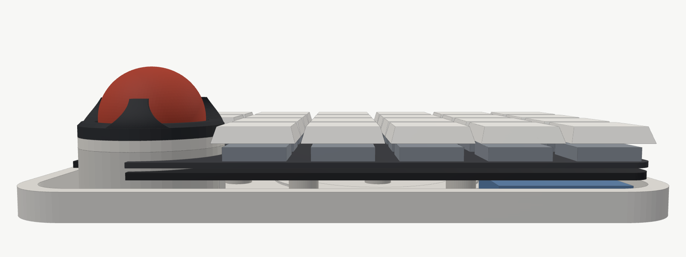
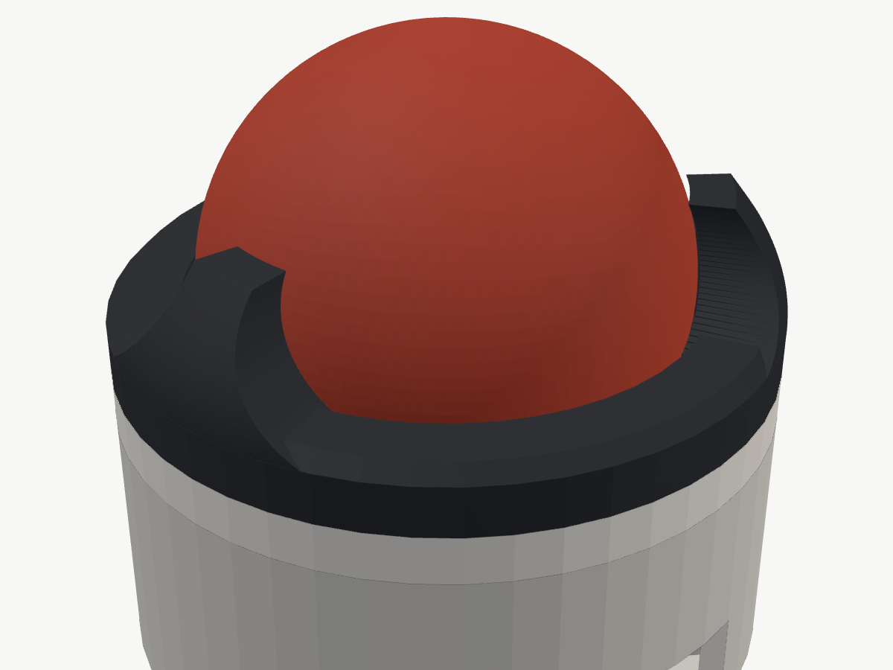
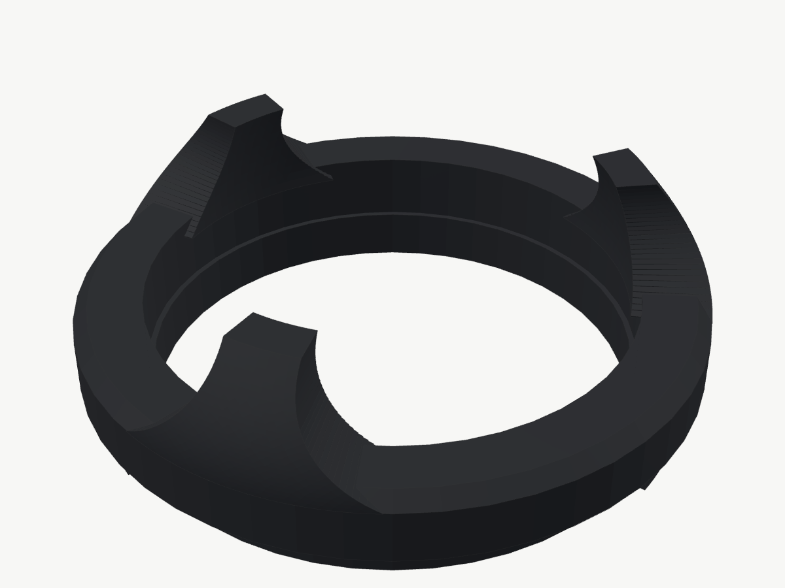
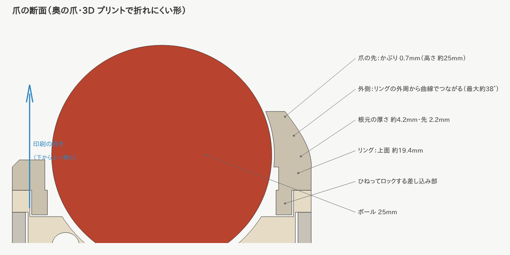
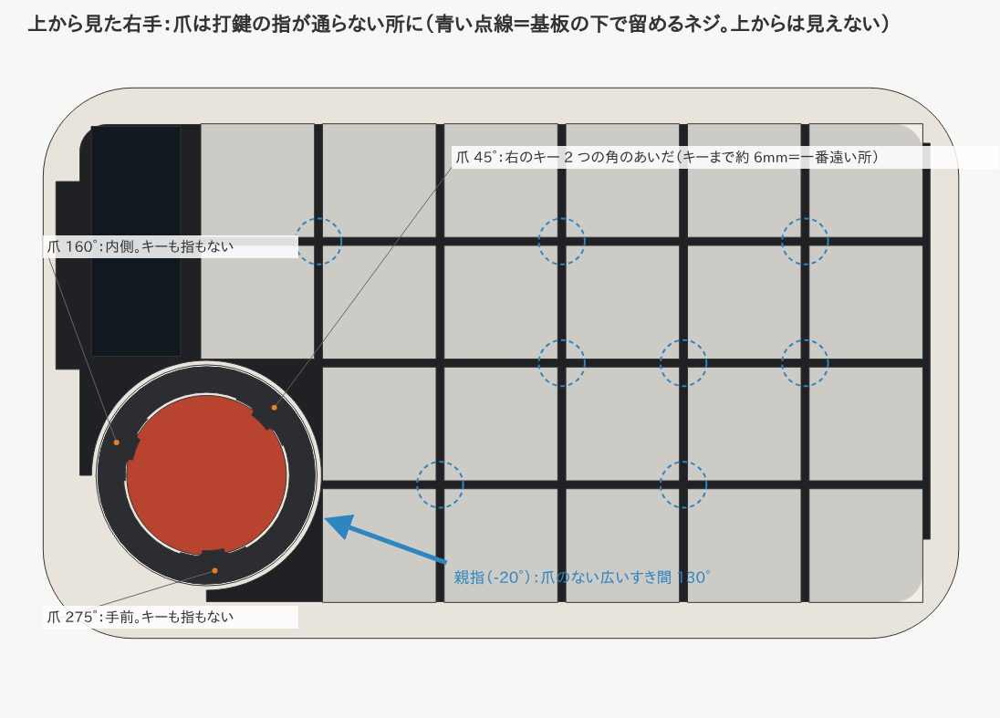

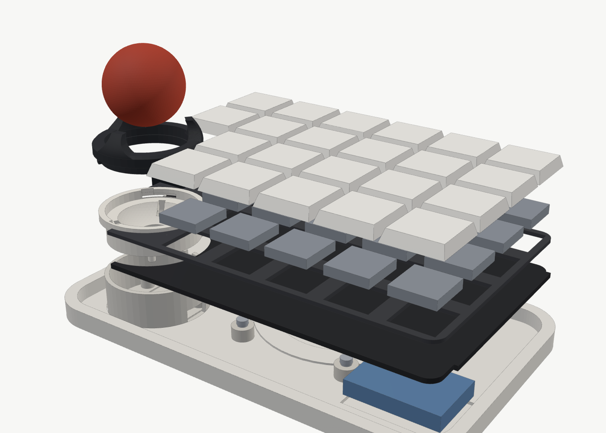

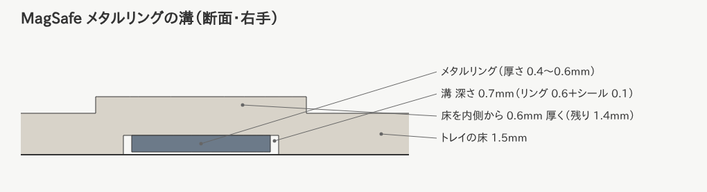
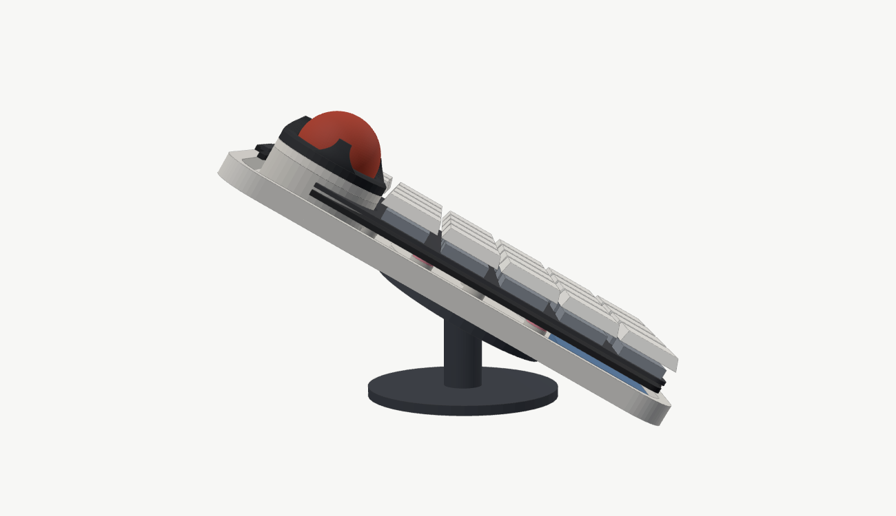
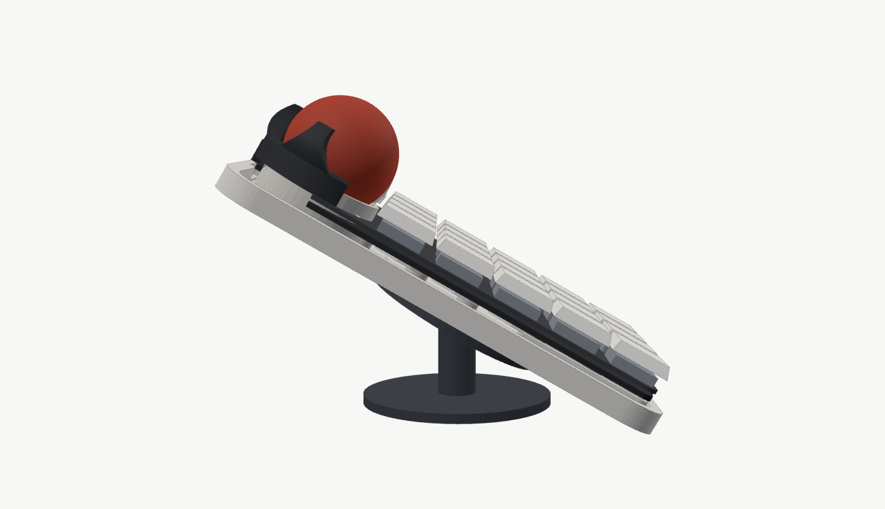
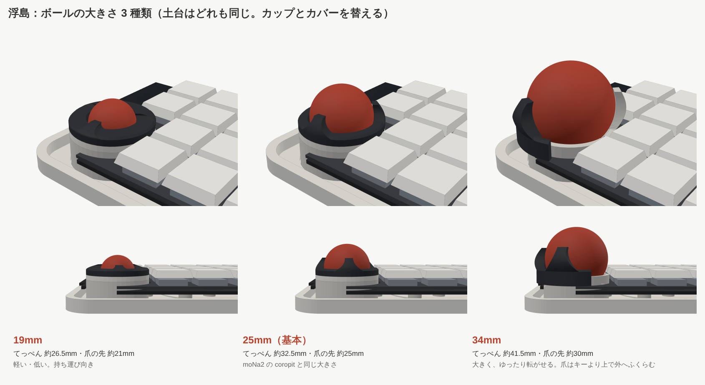
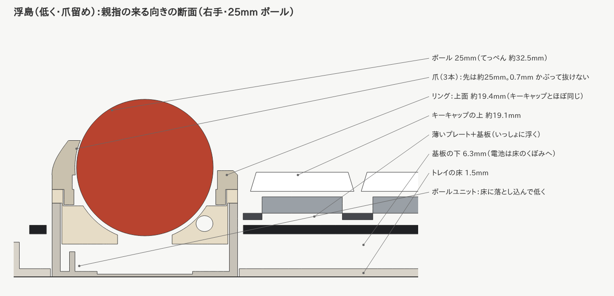

（前の版の絵：`ukishima-v1-*.png`。傾いた筒形のカバー・全体が約 1.2mm 高い）

## 変えないもの

XIAO nRF52840 Plus・nice!view・エンコーダー・46 キー・トラックボール（19 / 25 / 34mm）・無線の分割・Choc v2

## 構成

| 部分 | 内容 |
| --- | --- |
| トレイ | 低い枠（縁の高さ 7.5mm）と床。縁は**基板より低い**ので、横から見ると基板が浮いて見える |
| 支え方 | トレイから立てた柱 8 本（外周 6・内側 2。キーの角どうしのすき間）の上の**ポロン**に基板が乗り、**下からビス留め**。内側にも支えがあるので押し心地がそろう |
| 留め方（ビス） | **下から留めるので、上から見てネジが見えない**。基板の裏に **M2 はんだ付けナット（SMT ナット）**を付け、トレイの裏から M2 ネジ＋ワッシャー → **カラー 5mm**（ねじの無い筒）→ 柱の穴を触れずに通る → ナット。基板は柱の上のポロン（3mm → 締めて約 2.2mm）だけに乗っていて浮いたまま。カラーの長さで締めすぎを防ぐ（誰が組んでも押し心地が同じ）。ナットと柱のすき間 0.7mm がキーを押した時に沈める量。**プレートには穴もネジ山もない**ので、FR4 / POM / アルミのどれに替えても加工がいらない（1.2mm の FR4 / POM にネジ山を切ると山が少なく潰れやすいので、ナットは基板側に付ける）。ネジの頭は床のくぼみに沈む |
| 基板＋プレート | いっしょに浮く。プレートは薄め（スイッチが抜けにくく、しなり方もそろう） |
| ボールユニット | 机から立つ柱。トレイの床に落とし込み、土台の底も 1.0mm にして低くした。基板・プレートには触れない |
| カバー（爪留め） | **キーキャップとほぼ同じ高さの低いリング＋ボールの曲面に沿った細い爪 3 本**。宝石の爪留めのように、爪だけがボールの赤道より上で 0.7mm かぶって押さえる。爪のあいだはボールの横まで見え、親指で上からも横からも触れる。親指の来る向きには爪を置かない。ひねってロック |
| 爪の位置 | **45°**（右のキー 2 つの角のあいだ。リングのまわりでキーから一番遠い 約 6mm）・**160°**（内側）・**275°**（手前）。打鍵の指が通らない所だけに置く。一番広いすき間 130° の真ん中が親指の来る向き（-20°） |
| 爪の形と強さ | **外側の面がリングの外周（縦の面）からそのまま立ち上がり、なめらかにボール側へ曲がる**（段差なくリングに馴染む）。上から見ても根元は裾広がりの曲線（幅 根元 14mm → 先 4mm）。厚さは根元 約 4.2mm → 先 2.2mm。かぶりは 0.7mm |
| 低くする工夫 | トレイの床 1.5mm、電池は床のくぼみ（底 0.5mm）へ。基板の下のすき間を 7mm → 約 5.85mm に |

## 高さ（机から・25mm ボール）

| 部分 | 今の版 | 前の版（v1） | 最初のガスケット版 |
| --- | --- | --- | --- |
| ボールのてっぺん | **約 32.5mm**（19mm なら約 26.5mm） | 約 33mm | 約 35.5mm |
| カバーの一番高い所 | **爪の先 約 25mm**（細い爪 3 本だけ） | 奥側 約 32mm | 奥側 約 34.6mm |
| カバーのリング | **約 19.4mm**（キーキャップとほぼ同じ） | 親指側 約 21mm | 親指側 約 22.3mm |
| キーキャップの上 | **約 19.1mm** | 約 20.3mm | 約 21mm |
| トレイの縁 | 約 6.3mm | 7.5mm | （上ケース 16.5mm） |

## テンティング（MagSafe）

左右それぞれ、**トレイの裏に MagSafe のメタルリングを埋める溝**を掘った。市販の MagSafe スタンド（スマホ用・磁石入り）にくっつけて、好きな角度に傾けられる。

| 項目 | 内容 |
| --- | --- |
| リング | 市販の「MagSafe 用メタルリング」（鉄の薄いリング・シール付き）。磁石はスタンド側にあるので、キーボード側は鉄のリングだけでよい |
| 想定の寸法 | 外径 56・内径 46mm、**厚さ 0.4〜0.6mm**（買うリングの実寸に合わせて `MAG_OD / MAG_ID / MAG_T` を変える） |
| 溝 | すき間 0.3mm・**深さ 0.7mm**（0.6mm のリング＋シール 0.1mm で裏面とぴったり。0.4mm のリングなら 0.2mm 引っ込む＝くっつく力が少し弱まるだけで使える）。溝の真上は床の内側を 0.6mm 厚くして、床の残りを 1.4mm に |
| 位置 | 左：中心が重心とほぼ同じ。右：ボールの穴・電池・XIAO をよけて重心の近く。どちらも XIAO（無線のアンテナ）から 3cm 以上離れている（金属がアンテナの近くにあると電波が弱くなるため） |
| 電池と柱 | リングをよけるため、**電池の位置と柱 8 本の位置を変えた**（どのキーからも柱が近くなるように計算で選び直した。支え方の細かさは前の並びと同じくらい） |
| 注意 | メタルリングには向きを決める仕組みがないので、強く押すとスタンドの上で回ることがある。気になる場合はスタンドの面に薄いシリコンシートを貼ると止まりやすい |

### 傾けてもボールが浮かないように

ボールは 3 個のベアリングに乗っているので、傾けすぎると下り側のベアリングから外れて浮き、センサーとの距離（2.4mm）が変わって反応しなくなる。計算（ボールの重さと 3 個のベアリングの力のつり合い）で確かめて、次のように変えた。

| | 前 | 今 |
| --- | --- | --- |
| ベアリングの向き（上から） | 90° / 210° / 330° | **0° / 120° / 240°**（外側＝テンティングで下になる側に 1 個） |
| 25 / 19mm（ボールの中心から 45° 下で支える） | 約 29° まで | **約 45° まで**（前後に傾けた場合も含めて、どの向きでも約 26° まで） |
| 34mm | 55° 下で支える → 約 22° まで | **45° 下で支える → 約 45° まで** |

テンティングは 15〜30° がよく使われる角度なので、余裕がある。指で上から押す力はボールをベアリングに押しつける向きなので、使っている時はさらに安定する。

## ボールの大きさ（19 / 25 / 34mm）

19 / 25mm は土台（外径 34mm）が同じで、**カップとカバーを替える**。34mm は専用ユニット。画像は `ukishima-ball-19/25/34.png`。

| 大きさ | ボールのてっぺん | 爪の先 | メモ |
| --- | --- | --- | --- |
| 19mm | 約 26.5mm | 約 21mm | 一番低い。持ち運び向き |
| 25mm（基本） | 約 32.5mm | 約 25mm | moNa2 の coropit と同じ大きさ |
| 34mm | 約 41.5mm | 約 30mm | **34mm 専用ユニット**（下に説明）。人差し指と中指で転がす想定 |

### 34mm 専用ユニット

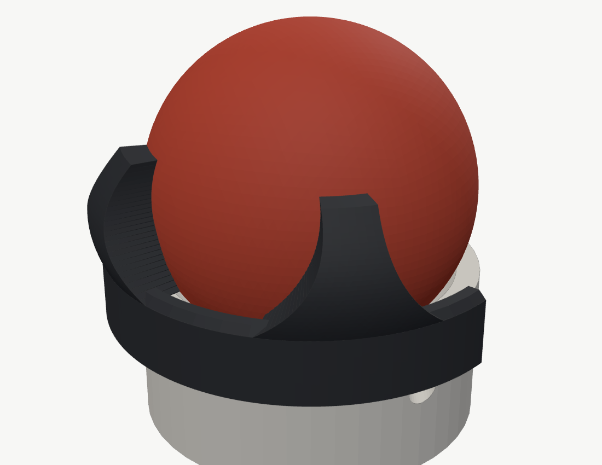
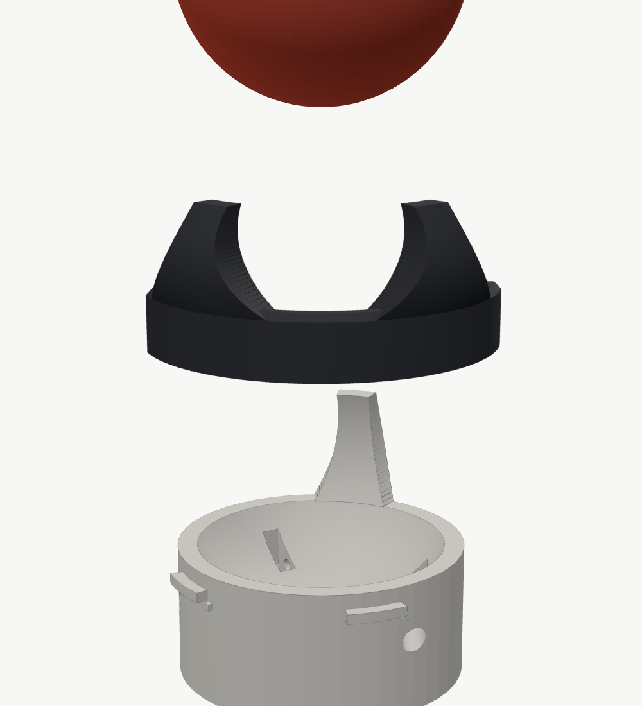

34mm はボールが重く指で押す力も大きいので、25 / 19mm と土台を共用せず専用にする。

- **土台とカップを一体**に（受けの壁が 2 重にならず厚い）。外径 35.4mm で基板の穴（36mm）に収まる。底（センサー・ネジ 3 本・ケーブルの出口）は 25 / 19mm と同じ。ベアリングは 25 / 19mm と同じ向き・同じ 45° で支える（テンティングでも浮かない）
- ボールの一番太い所（赤道・約 24.5mm）がキーキャップより上にあるので、**ボールの下半分を囲むリングは作れない**（リングがボールに引っかかってカバーが外せなくなる）。そこでカバーは、赤道より下ではボールの外側だけを通る形にした
- **爪 3 本**：45°（キーの角のあいだ）は**土台と一体の固定の爪**（回らないのでキーの角のすき間いっぱいまで太くできる）。170° と 250° は**カバー（フード）の爪**
- **カバー＝フード**：キーも基板もない左手前（140〜290°）を囲む C 形の壁（厚さ 2mm・高さ 約 7.6mm）。**外側でひねってロック**（ツメ 2 か所が土台の外の出っぱりの下に入る・最後にカチッ）。ボールを入れたままでも上へ外せる
- **ボールの出し方**：フードを外し、ボールを左手前へ 1mm ほど寄せながら持ち上げる（固定の爪の下をくぐる）
- 指の来る右手前（爪のすき間 155° の真ん中）は広くあけた
- 確認済み（計算）：キー（押し切った時も）・基板・プレート・nice!view・トレイに当たらない／フードを回す・外す時も当たらない／フードを付けるとどの向きにもボールが抜けない

## 爪留めカバーの 3D プリント（A1 mini などの初心者向けプリンター・PLA）

- **向き**：差し込み部を下にして、そのまま置く（爪が上へ伸びる）。爪の外側の曲面は最大でも約 38°、内側は約 20° しか傾かないので、**サポートなし**で印刷できる（45° まではサポート不要が目安）
- **おすすめの設定**（Bambu Studio の場合）
  - 積層ピッチ 0.12〜0.16mm（細かいほど層どうしがよくくっつき、爪の面もきれい）
  - 壁の周回数 6（爪が中まで壁で埋まる）、インフィル 100%（小さい部品なので時間・材料はほとんど増えない）
  - ノズル温度は PLA の推奨範囲の高め（例 215〜220℃）。層どうしの接着が強くなる
- **強さの目安**（計算上・PLA の層方向の強さを控えめに見た値）
  - 前の細い爪：爪 1 本あたり 約 0.6kgf で折れるおそれ
  - 今の爪：根元が厚く（約 4.2mm）幅も広い（約 14mm）ので、一番細い先の近くでも **約 5kgf 以上**。親指でボールを転がす力（数百 g）に対して 10 倍以上の余裕
- 実物で確かめること：かぶり 0.7mm でボールがしっかり止まるか・引っかからず回るか（プリンターの精度で ±0.1〜0.2mm ずれるので、0.6〜0.8mm の 3 種類を試し刷りするのがおすすめ）

## これから決めること

- 柱の押し心地（試作で確認。位置は基板の裏の部品と重ならないことを確認済み）
- はんだ付けナットの品番（M2・高さ 1.5mm 前後）。決まったら基板のパッドを合わせる
- 基板とプレートの色（縁がそのまま見えるので、デザインの要になる）
- トレイの素材・色（3D プリント／着せ替え）
- 34mm を指で使う時の手の置き場所（ボールの位置はこのままでよいか、試作で確認）
- 爪の本数・位置（試作で抜けにくさと触り心地を確認）
- 電池の厚さ（5mm より薄い PSE 品が見つかれば、さらに低くできる）
