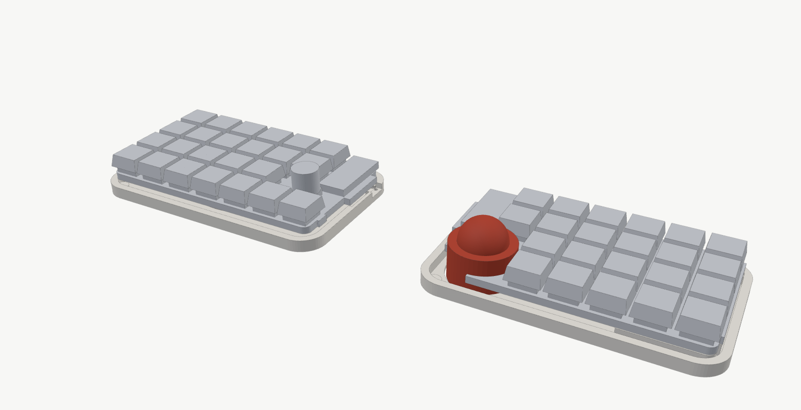
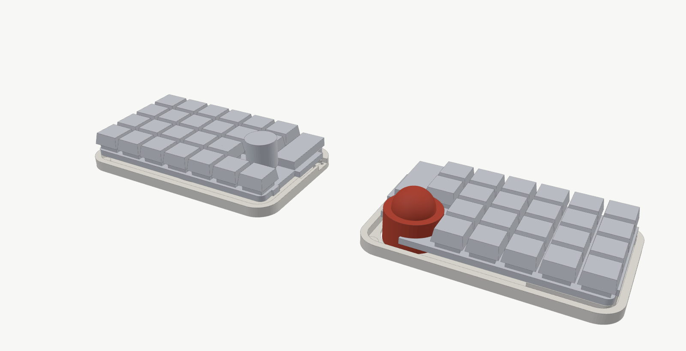
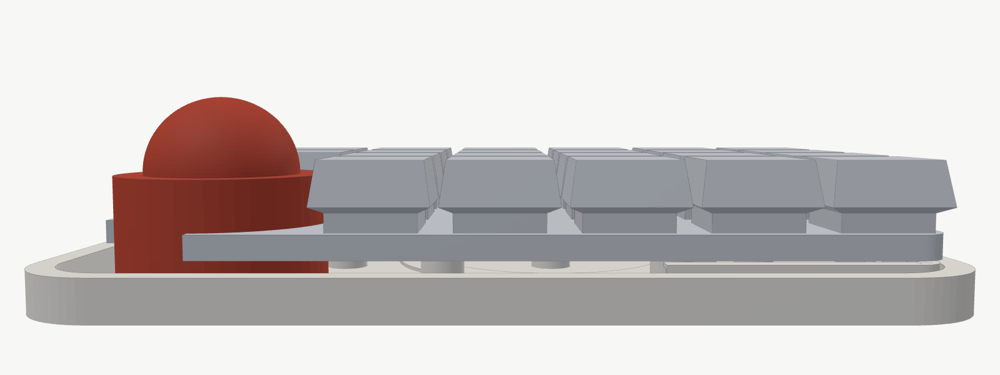

# kataware（浮島）部品リスト

キーボード 1 台（左右 1 組）を作るのに必要な物の一覧です。
**「設計の値」は今のデータが前提にしている寸法**です。実物（または販売ページ・データシート）の値を「実測」に書き、
違っていたら右端の数字（`case/concept_ukishima.py` などの名前）を直して作り直します。

- 数は左右の合計。「左／右」で分かれる物は（左 ○・右 ○）と書いた
- **高さ**は、基板の面から出る量（表は上へ・裏は下へ）
- ★ … 高さ・大きさがケースの形に効く物（実測してほしい物）

---

## 1. 電子部品（基板に付ける物）

| | 部品 | 規格・品番の例 | 数 | 付ける所 | 設計の値 | 実測 | 直す数字 |
| --- | --- | --- | --- | --- | --- | --- | --- |
| ★ | マイコン | Seeed XIAO nRF52840 Plus（**技適あり**・表面実装） | 2 | 基板の裏 | 20.95 × 17.8mm、**厚さ 5.0**（USB-C 込み・販売店の値） | | `XIAO_H` |
| ★ | 画面 | nice!view | 2 | 基板の表 | 36 × 14mm、**本体の厚さ 2.9** | | `VIEW_W/L`・`VIEW_TOP` |
| ★ | ピンヘッダー | 2.54mm ピッチ・5 ピン（オス） | 2 | nice!view と基板のあいだ | **樹脂の高さ 2.5**（付属のソケットなら 4.1）、足は裏で 2mm 以下に切る | | `VIEW_PCB_B`・`PIN_H` |
| ★ | キースイッチ | Kailh Choc v2（PG1353） | 46（左 24・右 22） | プレート | 基板の上面〜プレートの上面 **2.2**（Choc v2 の決まり） | | `PLATE_B/T` |
| ★ | ホットスワップソケット | Kailh Choc 用（CPG135001S30・LCSC C5333465）。**v2 専用のソケットは無く、v1 と同じ物** | 46 | 基板の裏 | **高さ 1.85**（データシート 1.80±0.05） | | `SOCKET_H` |
| ★ | ダイオード | 1N4148W（**SOD-123・表面実装**）。足付きは使わない | 47（左 25・右 22） | 基板の裏 | **高さ 1.35** | | `DIODE_H` |
| ★ | ロータリーエンコーダー | EC11（押し込みスイッチ付き） | 1（左） | 基板の表 | **本体 6.5・軸の先 20**（基板の上から・軸 20mm の EC11）。足は裏で 2mm 以下に切る | | `ENC_BODY_H`・`ENC_SHAFT_L` |
| ★ | エンコーダーのつまみ | 直径 15mm 前後・軸 6mm（D カット等） | 1 | エンコーダー | **直径 15**（大きい物は 直径 20） | | `ENC_KNOB_D` |
| ★ | 電源スイッチ | Alps SSSS811101（C&K PCM12 と同じ形） | 2 | 基板の表（舌） | **高さ 1.4**・レバーの高さ 基板の上 0.3〜1.2 | | `SW_LEVER_Z0/Z1` |
| ★ | 電池コネクタ | Molex PicoBlade 53261-0271（2 ピン・横向き・表面実装） | 2 | 基板の裏 | **高さ 約 3.4** | | `BACK_HEIGHTS`（molex） |
| ★ | センサー用コネクタ | JST SH BM06B-SRSS-TB（6 ピン・縦） | 1（右） | 基板の裏 | **高さ 4.25** | | `BACK_HEIGHTS`（jst） |
| ★ | はんだ付けナット | Würth WA-SMSI M2 高さ 1.5mm（9774015243）。代わり：PEM SMTSO-M2 | 16（左右 8） | 基板の裏 | **高さ 1.5・外径 4.35**（基板の穴 φ3.0・パッド φ5.3） | | `NUT_H`・`NUT_R`（基板のパッドも） |
| | 抵抗・コンデンサ | **不要**（XIAO に充電回路と電池の電圧を測る回路、PMW3610 の基板に電源回路が入っている） | — | — | — | — | — |

## 2. 電池・トラックボール

| | 部品 | 規格・品番の例 | 数 | 使う所 | 設計の値 | 実測 | 直す数字 |
| --- | --- | --- | --- | --- | --- | --- | --- |
| ★ | 電池 | Gexa GA-011（**PSE 認証**・250mAh・保護回路付き） | 2 | トレイの床のくぼみ | **20 × 30 × 5.0**（ばらつき +0.3 を見込む）・コネクタ付きのケーブル | | `BATTERY_T`・`BATTERY_TOL`・`BAT_W/H` |
| ★ | センサー | PMW3610 ブレイクアウト基板（レンズ付き） | 1 | ボールユニットの底 | **16 × 20mm・厚さ 1.6・レンズの高さ 3.0** | | `ball_unit.py` の `SENSOR_W/L/T`・`LENS_H` |
| | センサー用ケーブル | JST SH 6 ピン・1.0mm ピッチ（両端コネクタ）5〜10cm | 1 | センサー〜基板 | | | |
| ★ | トラックボール | 25mm（基本）／19mm／34mm | 1 | | 直径 | | `CUPS` |
| ★ | ベアリング | 681X（内径 1.5 × 外径 4 × 幅 2mm） | 3（カップ 1 個につき） | カップ | | | `BRG_R/W` |
| | ベアリングの軸 | M1.4 × 6mm なべタッピングネジ | 3（カップ 1 個につき） | カップ | | | |

## 3. ケース・ネジ（浮島）

| | 部品 | 規格・品番の例 | 数 | 使う所 | 設計の値 | 実測 | 直す数字 |
| --- | --- | --- | --- | --- | --- | --- | --- |
| | 基板 | 基板屋さんに注文（`pcb/ergogen/output/pcbs/`。KiCad で配線してから） | 2（左・右） | | 厚さ 1.6 | | |
| | プレート | FR4 1.2mm（`outlines/plate_*.dxf`） | 2 | | 厚さ 1.2 | | |
| ★ | カラー（ねじの無い筒） | 内径 2.1・外径 3・**長さ 5mm** | 16 | 柱の中 | 長さ 5（締めすぎ防止） | | `COLLAR_B` |
| | ネジ（基板） | M2 × 8mm（なべ・低頭） | 16 | トレイの裏から基板のナットへ | | | |
| | ワッシャー | M2・外径 5mm | 16 | | 厚さ 0.4 | | `WASHER_T` |
| ★ | ポロン | 3mm 厚（できれば片面テープ付き） | 小さいシート 1 枚 | 柱の上 | **締めて 1.9**（沈む量 0.4 がここで決まる） | | `PORON` |
| | ポンチ | φ7mm と φ4.5mm | 各 1 | ポロンの輪を抜く | | | `PORON_OD/ID` |
| ★ | MagSafe 用メタルリング | 外径 56・内径 46・**厚さ 0.4〜0.6**（シール付き） | 2 | トレイの裏 | | | `MAG_OD/ID/T` |
| ★ | ネオジム磁石 | φ6 × 2mm（N52 など） | 8 | トレイの裏の四隅 | | | `MAGNET_D/T` |
| ★ | ゴム足 | φ8 × 1mm | 8 | 磁石の上 | | | `RUBBER_D/T` |
| | 熱圧入インサート | M2・外径 3.2・長さ 4mm | 3 | ボールユニットの耳 | | | `INSERT_R/DEPTH` |
| | ネジ（ボールユニット） | M2 × 5mm 皿ネジ | 3 | トレイの裏から耳へ | | | |
| | ネジ（電源スイッチのカバー） | M2 × 6mm 皿タッピングネジ | 4 | トレイの裏からカバーへ | | | |
| ★ | キーキャップ | **MX 軸用のロープロファイル**（Choc v2 の軸は MX と同じ十字。Choc v1 用の MBK などは付かない） | 46 | | **プレートの上から 約 10.8**（スイッチ込み） | | `plate_to_keytop` |
| | 両面テープ・瞬間接着剤 | | 少し | 電池・磁石 | | | |
| | 3D プリントの材料 | PLA（または PETG）・黒と好きな色 | 1 巻 | トレイ・ボールユニット・カバー | | | |
| | （あれば）MagSafe スタンド | スマホ用 | 1〜2 | テンティング | | | |

## 4. 道具

はんだごて（温度調節つき）・はんだ・フラックス・ピンセット・ニッパー（足を切る）・精密ドライバー（＋0 番・M2 用）・
テスター（**電池のコネクタの＋−を必ず確かめる**）・ポンチ用の台とハンマー・3D プリンター

---

## 部品の候補と高さ（調べた値）

「この部品を選ぶと、だいたいこの高さ・大きさ」の早見表。**太字**が今のデータ（標準）、★印が一番大きい物（模型の「最大」に使った値）。
数字は販売ページ・データシートの値で、実物は少し違うことがある。

### Choc v2 用のホットスワップソケット

| 種類 | 品番 | 大きさ | 基板の裏に出る高さ | 使える？ |
| --- | --- | --- | --- | --- |
| **Kailh Choc ソケット** | **CPG135001S30**（LCSC C5333465） | 本体 9.55 × 6.85（はんだの耳込み 約 13.2） | **1.80±0.05**（データでは 1.85） | ◎ これが定番。**v1 / v2 共通**（v2 専用の物は無い）。抜き差し 100 回まで |
| 互換品（「1350 ソケット」などの名前） | 各社 | Kailh と同じとみなす | 約 1.8 | ○ 買ったら実測する |
| Mill-Max の丸ピンソケット | 0305 / 7305 / 3305 | 足 1 本ずつ | 約 1.7 / 0.7 / 1.45 | △ Choc の足には合わないことがある。基板の穴を大きくする必要がある。今の基板は非対応 |
| Gateron ロープロファイル用 | — | — | — | × Choc v1 / v2 には付かない |

### キーキャップ（ここが一番、高さに効く）

Choc v2 の軸は **MX と同じ十字**なので、キーキャップは **MX 軸用のロープロファイル**を使う。

| 種類 | 例 | キーキャップの高さ | プレートの上〜キーキャップの上（スイッチ込み・目安） |
| --- | --- | --- | --- |
| **MX 軸・ロープロファイル** | **Keychron LSA（4.4）**・Tai-Hao THT（4.5） | 4.4〜4.5 | **約 10.8** |
| ★ MX 軸・少し高い物 | Yuzu など（5.0） | 5.0 | 約 11.4 |
| （参考）Choc v1 ＋ MBK | Choc v1 用 | — | 約 7.5（**スイッチを Choc v1 に変える場合**。基板はそのまま使える） |

### マイコン・画面

| 部品 | 付け方 | 大きさ | 基板から出る高さ |
| --- | --- | --- | --- |
| XIAO nRF52840 Plus | 裏に表面実装 | 20.95 × 17.8 | **約 5.0**（USB-C 込み）。基板だけなら 約 1.2 |
| nice!view | **2.54mm ピンヘッダー（樹脂 2.5）** | 36 × 14 × 2.9 | **約 5.4** |
| nice!view | Mill-Max のロープロファイルソケット | 同上 | 約 5.0 |
| nice!view | ★ 付属のソケット | 同上 | 約 7.0 |

### ロータリーエンコーダー

| 種類 | 軸 | 基板の上〜つまみの上（目安） | トレイの底から |
| --- | --- | --- | --- |
| EC12E（中空軸） | 軸なし（低い） | 約 8.5 | 約 18 |
| EC11 | 15mm | 約 20 | 約 24.75 |
| **EC11** | **20mm** | **約 20** | **約 29.75** |
| ★ EC11 | 20mm（製品の高さ 25） | 約 25 | 約 34.75 |
| つまみ | — | **直径 15**（★ 直径 20 × 高さ 20 まで） | |

### コネクタ・スイッチ・小さい部品

| 部品 | 品番 | 基板から出る高さ |
| --- | --- | --- |
| 電池コネクタ | **Molex PicoBlade 53261（横）** | **3.40** |
| センサー用コネクタ | **JST SH BM06B-SRSS-TB（縦）** | **4.25** |
| センサー用コネクタ（低い） | JST SH SM06B-SRSS-TB（横） | 2.90 |
| （参考）JST GH | — | 4.25 |
| 電源スイッチ | **Alps SSSS811101**・C&K PCM12・MSK12C02 | **1.4**（★ 販売店の「製品の高さ」1.9） |
| ダイオード | **SOD-123（1N4148W）** | **1.35 以下** |
| ダイオード（低い） | SOD-323（1N4148WS） | 1.1 以下 |
| はんだ付けナット | **Würth WA-SMSI M2**（高さ 0.5〜8 の物がある）／PEM SMTSO-M2 | **1.5**（外径 4.35） |

### 電池（すべて PSE 認証・Gexa）

| 品番 | 大きさ（幅 × 長さ × 厚さ） | 容量 | 今の電池のくぼみに |
| --- | --- | --- | --- |
| GA-010 | 20 × 25 × 4 | 150mAh | 入る（小さい） |
| **GA-011** | **20 × 30 × 5** | **250mAh** | **ぴったり（今のデータ）** |
| GA-012 | 30 × 48 × 4 | 500mAh | 入らない（くぼみと基板を作り直し） |
| GA-015 | 34 × 52 × 5 | 1000mAh | 入らない（同上） |
| 普通の 502030 | 20 × 30 × 5.0±0.2 | 約 250mAh | 入る（**PSE 認証を必ず確認**） |

- 厚さは「ばらつき・ふくらみ +0.3」を見込んで、**5.3mm までは基板の裏の部品に当たらない**ように作ってある

---

## 模型（モック）で大きさと高さを確かめる

部品を買う前に、**大きさと高さだけ**の模型を印刷して手を置いてみる。2 通りある：

| フォルダ | 寸法 | 作り直し | キーキャップの上 | nice!view のカバーの上 | つまみの上 |
| --- | --- | --- | --- | --- | --- |
| `case/stl/mock/` | 標準（`case/parts_dims.json`） | `python3 case/mock.py` | 22.75 | 16.15 | 29.75 |
| `case/stl/mock_worst/` | **候補で一番大きい部品**（`case/parts_dims_worst.json`） | `python3 case/mock.py --worst` | 23.35 | 17.75 | 34.75 |

（高さはトレイの底から・mm。ゴム足の分 0.4 高くなる。基板の下 8.15・プレートの上 11.95 は両方同じ）

「最大」は：キーキャップ 5.0mm の MX 軸ロープロファイル・nice!view を付属のソケットで付ける（7.0）・エンコーダー EC11 の軸 20mm で製品の高さ 25・つまみ 直径 20・
電源スイッチ 1.9。**最大の模型で問題なければ、どの候補を選んでも収まる**。

標準 ／ 最大：

| STL | 中身 | 大きさ（標準 ／ 最大） | 印刷 |
| --- | --- | --- | --- |
| `mock_tray_left` / `_right` | 本物と同じトレイ（柱だけポロンの分まで高い） | 143 × 86 × 8 | 床を下 |
| `mock_top_left` | 基板＋プレート＋スイッチ＋キーキャップ＋nice!view（カバー込み）＋エンコーダー | 136 × 76 × 22 ／ 27 | 下の平らな面を下（キーキャップのふちに少しだけ張り出し） |
| `mock_top_right` | 同じ（エンコーダー無し） | 137 × 76 × 15 | 同上 |
| `mock_ball_19` / `_25` / `_34` | ボールユニットとボールの外形 | 34〜35 角・高さ 26 / 32 / 42 | 底を下 |

- どれも **Bambu Lab A1 mini（180 × 180 × 180mm）に 1 個ずつ入る**（プログラムが大きさを確かめている）
- **早く・安く**印刷する設定でよい（積層 0.28mm・インフィル 10%・壁 2 周）。形を見るだけなので、色も 1 色で OK
- 組み方：トレイに上の模型を乗せる（柱の上に乗る）。右手はボールの模型をトレイの穴に入れる
- 確かめること：手を置いた時の高さ・キーの位置とボールの距離・持ち運ぶ時の大きさ・エンコーダーのつまみの高さ
- **部品を実測して `case/parts_dims.json` の数字を直したら、もう一度 `python3 case/mock.py` を実行**すると、模型の高さも変わる
