# 浮島（うきしま）の作り方 — 製作用データ

kataware の今の製作用の形「浮島」の、**データ・買う物・3D プリント・組み立て**をまとめたページです。
考え方や経緯は [docs/concept/](concept/README.md)（構想のページ）にあります。

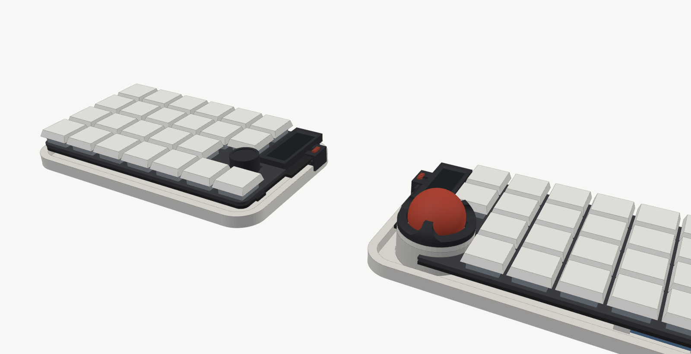
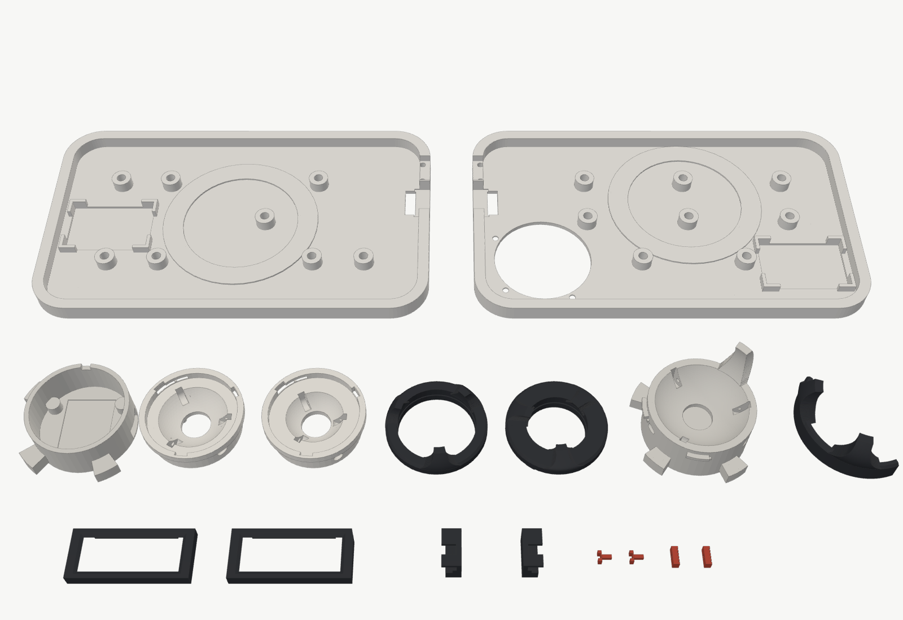

## 1. 構成

| 部分 | 内容 |
| --- | --- |
| トレイ（3D プリント） | 床 1.5mm＋**低い縁（高さ 6.65mm＝基板の下面より 1.5mm 低い）**。縁と基板のあいだに一周同じ**影のすき間**ができ、基板とプレートが浮いて見える。縁の内側には**リップ**（基板の縁の下へ 2.5mm 入る低い帯）が一周して、すき間から電池や基板の裏が見えない（目隠しの壁は不要）。床から**柱 8 本**が立ち、**基板はその上のポロンに乗って浮く**。裏に MagSafe メタルリングの溝、床に電池のくぼみ |
| 基板（PCB） | 裏に **M2 はんだ付けナット 8 個**。トレイの裏からネジで留める（上からネジが見えない） |
| プレート | Choc v2 用。**耳もネジ穴もない**。スイッチで基板にくっつき、基板といっしょに浮く |
| ボールユニット（右手） | **受け（下ケース）はトレイと一体**（センサー基板はここにツメで留めたまま・ネジなし）＋**上の部品**（カップ＋爪 3 本のカバー / 34mm はカップ＋フード）。ボールの大きさを替える時は、カップと球押さえを組んだ**サイズ別のボールユニットを丸ごと差し替える**（受けは 19 / 25 / 34mm 共通）。ユニットは受けに差し込んで**反時計回りに 20° ひねる**とロック（カチッ）。球押さえは時計回りに締まるので、ボールを外す時にユニットがゆるまない。受けの付け根は**半径 10mm のアール**でトレイの床になだらかにつなぐ（基板の裏の部品・34mm のフードが回る所はよける）。**どれも左手前へ 30° 傾けた形**で、爪は斜め 3 か所（45° / 135° / 315°）。親指の来る左手前を 180° あけ、前後・左右に転がしやすい。**34mm も親指で転がす**（45° の爪はカップと一体、135° / 315° はフードの爪） |
| ボールの形・デッキ | ボールのまわりの切り欠きは、**別部品のデッキ**（プレートと同じ色で印刷）で、プレートの上面の高さまで埋める。外形は基板の四角にそろえ、外側の縁の下は 1.5mm えぐって影を見せる → **「プレート＋デッキ」が 1 枚の四角い島**に見える。デッキはトレイ（リップ・受けのアール）に乗り、トレイの裏から M2 ネジ 1 本で留める。34mm の時はフードがその角に来るので、デッキは外す。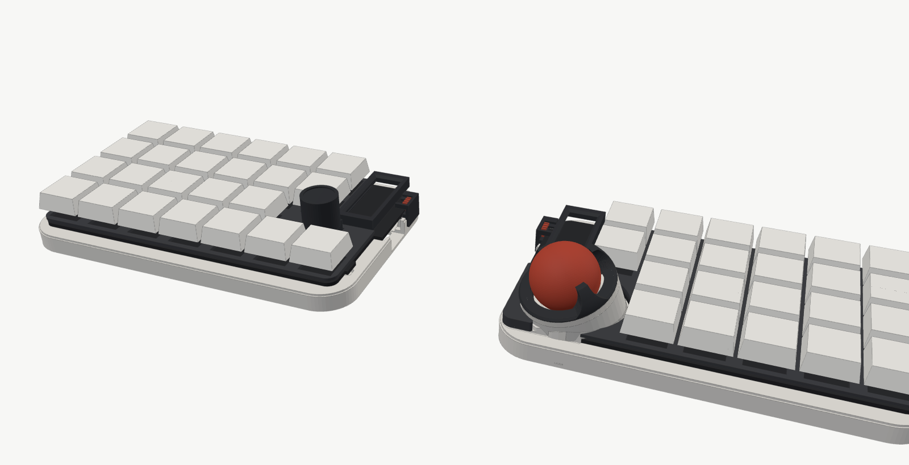 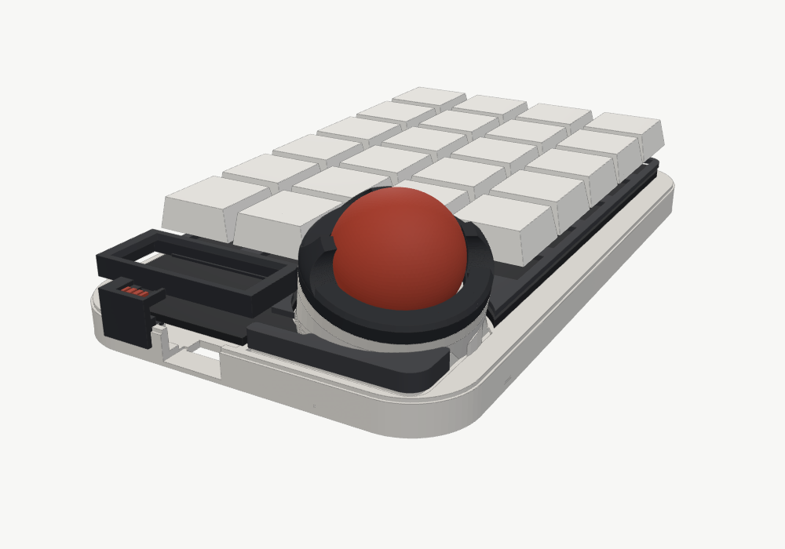 |
| テンティング | MagSafe スタンドにくっつけて傾ける（約 45° までボールが浮かない） |
| 四隅の磁石＋ゴム足 | トレイの裏の四隅に**ネオジム磁石**を埋め、その上に**ゴム足**を貼る。机ではゴム足が滑り止め（テンティングなしで使える）。**持ち運ぶ時は、左手を左右にひっくり返して右手の裏に重ねると、四隅の磁石でくっつく** |
| 電池 | トレイの床のくぼみ（深さ 1mm）に置き、**四隅の L 形のガイド**（高さ 3mm）で囲む。上は基板の裏まで 0.5mm なので浮き上がらない |
| 沈む量 | キーを押した時に基板が沈めるのは**最大 0.4mm**（ナットと柱のすき間）。これ以上沈むと、電池の上のソケットが電池に当たるため |
| 基板の裏のソケット | キーのソケットは基板の裏に付く（高さ 約 1.85mm）。柱・ポロン・電池・トレイの縁・ボールの受け・電源スイッチのカバーとは、基板が一番沈んだ時も当たらないことを計算で確認。外側の列のソケットがトレイの縁の角にかかる所だけ、縁を少し削ってある |
| コネクタの位置 | 電池・センサーのコネクタは、裏のソケットとぶつからない空きに置いた。**電池のケーブル（約 3〜4cm）とセンサーのケーブルは、基板の下（床とのすき間 約 4.5mm）を通してコネクタまで引き回す** |
| 電源スイッチ | 横のスライドスイッチはトレイの外の面より約 1mm 奥にあるので、**カバー＋上のつまみ**を付ける。つまみを前後に滑らせると、下の「フォーク」がレバーを動かす（基板が沈んでも引っかからないよう、フォークは上下に余裕がある）。**つまみは屋根のくぼみに沈めてあり（上面が屋根より 0.1mm 低い）、持ち運びで物が擦れても動きにくい**。スイッチ自体にもカチッと止まる手ごたえがある |
| nice!view | **窓あきのカバー**を nice!view にかぶせる（長い辺の小さな爪が nice!view の基板のふちの下に入って止まる）。プレートはこのカバーが入るように角を切ってある |

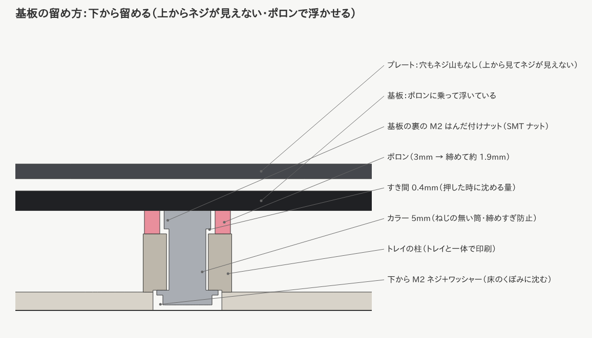
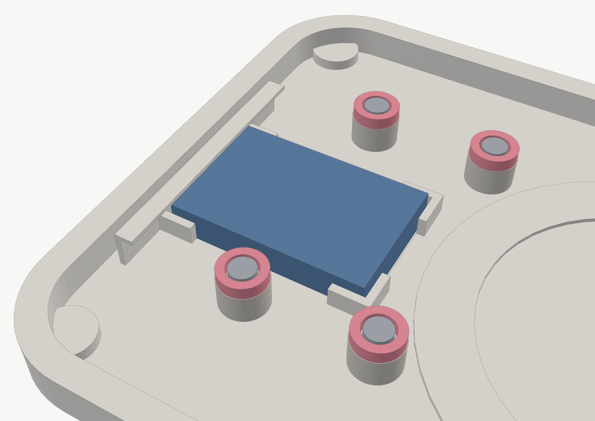
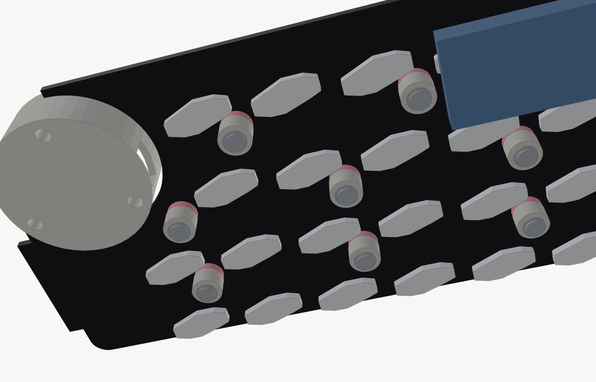
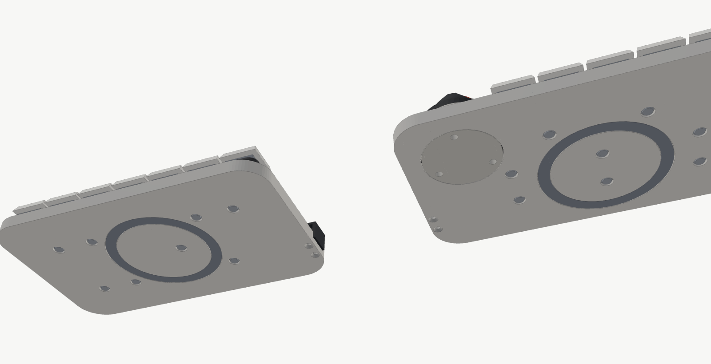
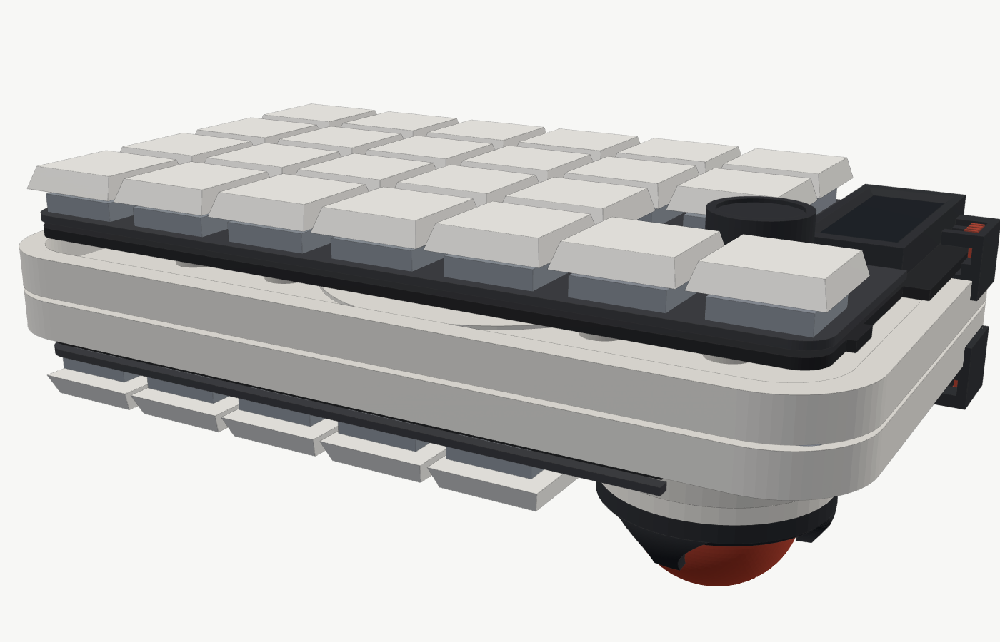
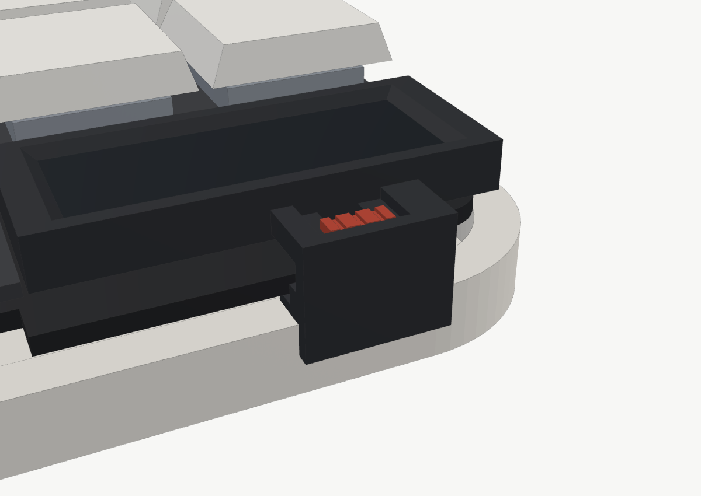
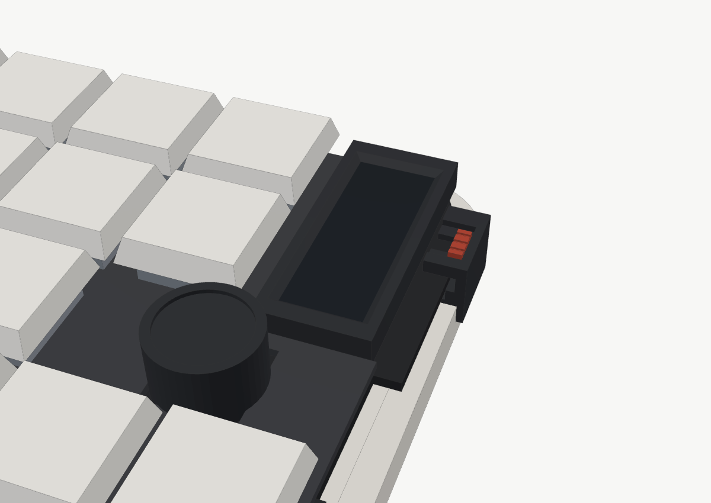

### 基板に付ける部品（全部）

| 部品 | 規格・品番の例 | 左 | 右 | 付ける面 | 基板から出る高さ |
| --- | --- | --- | --- | --- | --- |
| キースイッチ | Kailh Choc v2（PG1353） | 24 | 22 | 表（プレートにはめる） | プレートの上へ（**MX 軸用ロープロファイル**キーキャップ込みで 約 10.8） |
| ホットスワップソケット | Kailh Choc 用（CPG135001S30） | 24 | 22 | **裏** | 1.85 |
| ダイオード | **1N4148W（SOD-123・表面実装）** | 25 | 22 | **裏** | 1.35 |
| マイコン | XIAO nRF52840 Plus（表面実装） | 1 | 1 | **裏** | 5.0（USB-C 込み） |
| 画面 | nice!view | 1 | 1 | 表 | 5.4（ピンヘッダーの樹脂 2.5 ＋ 本体 2.9）。付属のソケットだと 約 7.0 |
| ピンヘッダー | 2.54mm・5 ピン（nice!view 用） | 1 | 1 | 表（足は裏） | 足は裏で 2mm 以下に切る |
| ロータリーエンコーダー | EC11（押し込み付き・軸 20mm） | 1 | — | 表（足は裏） | 本体 約 6.5・軸の先 約 20。足は裏で 2mm 以下に切る |
| 電源スイッチ | Alps SSSS811101（PCM12 と同じ形） | 1 | 1 | 表（基板の舌） | 1.4 |
| 電池コネクタ | Molex PicoBlade 53261（2 ピン・横） | 1 | 1 | **裏** | 約 3.4 |
| センサー用コネクタ | JST SH BM06B-SRSS-TB（6 ピン・縦） | — | 1 | **裏** | 4.25 |
| M2 はんだ付けナット | Würth WA-SMSI M2 高さ 1.5mm（9774015243・外径 4.35） | 8 | 8 | **裏** | 1.5 |
| 抵抗・コンデンサ | **なし**（XIAO に充電回路と電池の電圧を測る回路、PMW3610 の基板に電源回路が入っている） | — | — | — | — |

- ダイオードの足付き（1N4148 など）は**使わない**。表に付くと、基板とプレートのすき間（1mm）に入らない。足付き用の穴もあるが、表面実装の SOD-123 を裏に付ける
- エンコーダーとピンヘッダーの足は、はんだ付けの後に**裏で 2mm 以下に切る**（下の柱や電池に当たらないように）

### 高さの積み上げ（トレイの底から・mm。ゴム足の分 0.4 高くなる）

基板の下は、一番きびしい「**電池の上にソケットが来る所**」で決めた：
床のくぼみの底 0.5 ＋ 電池 5.0（ばらつき・ふくらみ +0.3）＋ すき間 0.1 ＋ 沈む量 0.4 ＋ ソケット 1.85 ＝ **基板の下面 8.15**

| 高さ | もの |
| --- | --- |
| 0〜1.5 | トレイの床（電池のくぼみの底は 0.5） |
| 5.5（最大 5.8） | 電池の上面 |
| 2.75〜 | XIAO の下面（基板が一番沈んだ時。床まで 1.25 あく） |
| 3.5 / 4.35 | センサー用コネクタ / 電池コネクタの下面（一番沈んだ時） |
| 5.75 | エンコーダー・nice!view の足の先（一番沈んだ時） |
| 5.9 | ソケットの下面（一番沈んだ時。電池の最大より 0.1 上） |
| 6.25 / 6.65 | 柱の上面 / ナットの下面（このすき間 0.4 が、キーを押して基板が沈める量） |
| 8.15〜9.75 | **基板**（1.6mm） |
| 6.65 | トレイの縁（基板の下面より 1.5 低い → 影のすき間で浮いて見える）。内側のリップは 7.45 |
| 10.75〜11.95 | プレート（1.2mm。Choc v2 は基板の上面からプレートの上面まで 2.2）。**デッキの上も 11.95** |
| 13.6 | 電源スイッチのカバーの屋根 |
| 15.15 / 16.15 | nice!view の上 / nice!view のカバーの上（付属のソケットだと 16.75 / 17.75） |
| 19.75 | ボールの爪留めカバーのリングの上（キーキャップより低い） |
| 約 22.75 | **キーキャップの上**（MX 軸用ロープロファイル。キーキャップによる。一番高い物で 約 23.35） |
| 約 29.75 | エンコーダーのつまみの上（軸 20mm の時。軸 15mm なら 約 24.75、EC12E の中空軸なら 約 18） |
| 30.9 / 36.5 / 44.9 | ボールのてっぺん（19 / 25 / 34mm・30° 傾けた時） |

- `python3 case/ukishima.py` は、**基板の裏の全部品**（ソケット・XIAO・コネクタ・ダイオード・ナット・足）を、この高さの形にして、
  基板が一番沈んだ時もトレイ・柱・ポロン・電池（厚めの物）・トレイの縁とリップ・ボールの受け・デッキ・電源スイッチのカバーに当たらないことを確かめる
- XIAO の USB-C 側の端は、トレイの壁の上に 1.5mm はみ出すので、その下だけ壁を低く掘ってある（外側の縁は残る）

## 2. データ

| データ | 場所 | 作り直し方 |
| --- | --- | --- |
| 基板（KiCad） | `pcb/ergogen/output/pcbs/left.kicad_pcb`・`right.kicad_pcb` | `npx ergogen@4.1.0 pcb/ergogen -o pcb/ergogen/output` → KiCad で配線（[KiCad の手順](kicad-guide.md)） |
| プレート（DXF） | `pcb/ergogen/output/outlines/plate_left.dxf`・`plate_right.dxf` | 同上。FR4 1.2mm で基板屋さんに注文できる |
| 3D プリント（STL） | `case/stl/ukishima/` | `python3 case/ukishima.py`（先に Ergogen を実行） |
| 検査 | — | `python3 tools/check_pcb.py`（基板）・`python3 case/ukishima.py` の最後の「確認」（ケース） |

`case/ukishima.py` は STL を作ったあと、次を計算で確かめて「確認: 問題なし」と出す：
基板のナットとトレイの柱の位置が同じ／ボールユニットがキー（押し切った時も）・基板・プレート・柱・電池に当たらない／
カバーを回す途中も当たらない／四隅の磁石が穴・溝・電池・ボールユニットの耳・XIAO・電源スイッチのカバーに近すぎない／MagSafe の溝が壁に近すぎない／ユニットの耳が基板の裏の部品の下に来ない

`tools/check_pcb.py` は、パッドどうしの近さ・基板の端・**基板の裏の部品どうしの重なり**・**電池の上に背の高い部品が来ていないか**を確かめる。

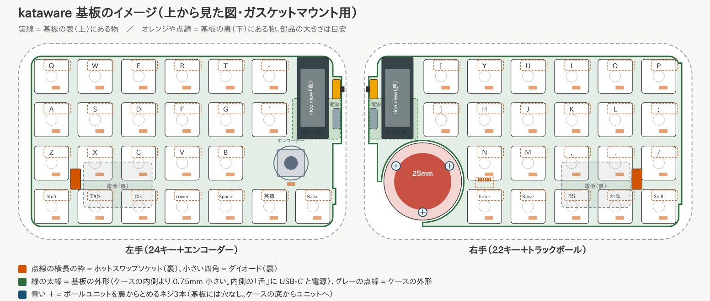
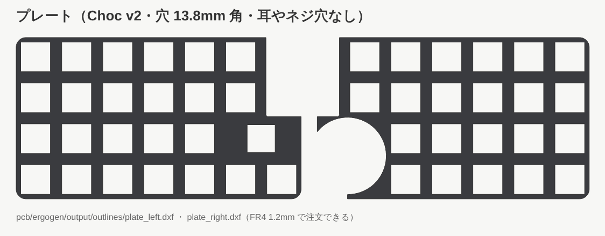

### センサー基板の収め方（右手のボールユニット）

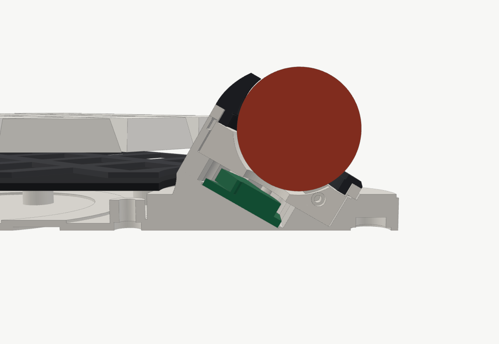

- **センサー基板の条件**：4 隅の近く（カップの足が押さえてひねる時に通る所・直径 2.4mm の円弧）には部品を置かない
- **置き方**：PMW3610 の基板を、トレイと一体の受けの床のくぼみ（深さ 0.5mm）に入れ、短い辺の**ツメ 2 つにパチッとはめる**。位置はくぼみで決まり、カップを外しても基板は抜けない（使う人が基板を外す必要はない）
- **押さえ方**：上からカップを入れると、カップの足 4 本が基板の 4 隅を押さえる（ネジ・接着なし）。レンズはカップの底の窓からボールを見る
- **コネクタ**：**横向き**の JST SH 6 ピン（SM06B など・高さ 2.9mm）を、基板の**右の辺**（基板のコネクタ J の方）に付ける。
  縦向き（4.25mm）はカップの底に当たるので使わない
- **ケーブル**：コネクタの横の床の穴から、受けの下の台の中をまっすぐ下りて、右の窓から床の上へ出る → 床の上を通って基板の裏のコネクタ J へ（5〜10cm）
- 基板の大きさ・レンズの高さは `case/parts_dims.json` の `sensor_w` / `sensor_l` / `sensor_t` / `lens_h`。使う基板が決まったら実測して直すと、
  くぼみ・カップの足・ボールの高さがそれに合わせて作り直される（今は 16 × 20 × 1.6mm・レンズ 3.0mm。一番大きい値のファイルはレンズ 4.0mm）
- ボールの高さはセンサー基板の一番低い角で決まる（床が 0.6mm 残るまで沈めてある）。小さい基板ほどボールを低くできる

## 3. 3D プリント（A1 mini などの初心者向けプリンター・PLA でよい）

| STL | 個数 | 置く向き | サポート | メモ |
| --- | --- | --- | --- | --- |
| `tray_left` / `tray_right` | 各 1 | 床を下 | なし（右の受けのケーブルの窓は橋渡し） | 143 × 86mm（A1 mini に入る）。裏の溝・穴は「橋渡し」で印刷できる |
| `ball_cup_25` / `ball_cup_19` | 各 1 | **上の縁を下（裏返し）** | なし | ベアリングの溝は上から入れる形 |
| `ball_cover_25` / `ball_cover_19` | 各 1 | 差し込み部を下 | なし | 爪は最大 約 38° しか傾かない |
| `ball_cup_34` | 1（34mm を使う時） | 足を下（固定の爪が上） | 足のまわり・ロックの出っぱりの下（ツリー） | ベアリング 3 個・センサーを押さえる足 4 本・45° の固定の爪・フードのロックの出っぱり |
| `ball_deck` | 1（19 / 25mm の時） | 上の面を下 | なし | **プレートと同じ色**（黒など）で印刷 |
| `ball_hood_34` | 1（34mm を使う時） | フードの下の面を下 | なし | 爪 2 本（135° / 315°）。親指側 (左手前) の低い壁 |
| `switch_cover_left` / `_right` | 各 1 | 書き出した向きのまま（外の面が下） | なし | 屋根は横向きの壁として印刷される |
| `switch_slider`（つまみ＋フォーク） | **2** | 書き出した向きのまま（つまみが下） | なし | 小さい部品。0.4mm ノズル・積層 0.12mm で |
| `view_cover_left` / `_right` | 各 1 | 書き出した向きのまま（上の面が下） | なし | 窓のふちは斜め。爪は最後に積まれる |

おすすめの設定（Bambu Studio）：積層 0.12〜0.16mm・壁 4〜6 周・インフィル 30%（爪のある部品は 100%）・ノズル温度は高め（例 215〜220℃）

⚠️ 実物合わせが必要な所：ナットのパッド（品番による）・メタルリングの外径と内径・PMW3610 の基板の大きさ・XIAO のリセットボタンの穴・USB-C の切り欠き・**電源スイッチのレバーの高さ**（`SW_LEVER_Z0/Z1`）・**nice!view の高さと画面の窓**（`VIEW_PCB_B`・`VC_WIN_W/L`）。
**まずトレイを 1 枚だけ印刷して、基板と部品を当ててから**残りを印刷する。

## 4. 買う物（浮島で増える物）

全部の部品（電子部品も含む・寸法と実測欄つき）は **[部品リスト](parts-list.md)**。部品を買う前に、同じページの**模型（モック）**で大きさと高さを確かめられる。

キースイッチ・XIAO・nice!view などの基本の部品は [README の「次にやること」](../README.md#9-次にやることハードウェア)。ここは浮島のケースで使う物。

| 部品 | 数 | メモ |
| --- | --- | --- |
| M2 はんだ付けナット（SMT ナット） | 16（左右 8 ずつ） | Würth WA-SMSI M2 高さ 1.5mm（9774015243・外径 4.35）。基板の裏にはんだ付け（基板の穴 φ3.0・パッド φ5.3） |
| M2 × 8mm ネジ（なべ・低頭） | 16 | トレイの裏から入れる |
| M2 平ワッシャー（外径 5mm） | 16 | |
| カラー（ねじの無い筒：内径 2.1・外径 3・長さ 5mm） | 16 | **締めすぎ防止**。これの長さでポロンのつぶれ具合が決まる |
| ポロン（3mm 厚・できれば片面テープ付き） | 小さいシート 1 枚 | **φ7mm と φ4.5mm のポンチ**で輪を 16 枚抜く（外 7・内 4.5） |
| MagSafe 用メタルリング（シール付き） | 2 | 外径 56・内径 46mm・厚さ 0.4〜0.6mm を想定（違う物はデータを直す） |
| ネオジム磁石 φ6 × 2mm（N52 など強いもの） | 8（左右 4 ずつ） | トレイの裏の四隅に入れる。**極の向きに注意**（下の組み立て 4） |
| ゴム足（直径 8mm・厚さ 1mm） | 8 | 磁石の上に貼る（くぼみ 0.6mm → 0.4mm 出る） |
| M2 × 6mm 皿タッピングネジ | 4（左右 2 ずつ） | トレイの裏から電源スイッチのカバーへ |
| ベアリング 681X ＋ M1.4 × 6mm なべタッピングネジ | 3 組（カップ 1 個につき） | 19 / 25mm カップ・34mm の受けそれぞれに 3 組 |
| トラックボール | 19 / 25 / 34mm のどれか | |

## 5. 組み立て

1. **基板**：ソケット・ダイオード・XIAO などをはんだ付け（README の手順）。最後に**裏の M2 ナット 8 個**をはんだ付けする
   （ネジを 1 本ナットに通して、パッドの真ん中に立てるとまっすぐ付けやすい）
2. **プレート＋スイッチ**：プレートにスイッチをはめ、基板のソケットに挿す（基板・プレート・スイッチが一体になる）
3. **トレイ（右）**：センサー基板のケーブルを受けの床の穴から下へ通して右の窓から床の上へ出し、基板を受けのくぼみにはめる（ツメにパチッと）。
   基板の裏のコネクタ J にはあとでつなぐ
4. **トレイ（両方）**：裏に**メタルリング**を溝に合わせて貼る・**電池**を床のくぼみ（四隅のガイドの中）に置く（両面テープ）。
   裏の四隅に**磁石**を入れる（瞬間接着剤を少し）。**上から見て（トレイを机に置いた向きで）左側の 2 個は N 極を下、右側の 2 個は S 極を下**（左右のトレイとも同じ）。
   入れる前に、左手の磁石と右手の磁石がくっつく向きか確かめると安心。最後に**ゴム足**を磁石の上に貼る
5. **ポロンの輪**を 8 本の柱の上に貼る
6. 基板一式をトレイに乗せ、電池とセンサーのケーブルを基板の下（床の上）で引き回して、基板の裏のコネクタに挿す（柱やネジの穴をふさがないように）
7. **トレイの裏から**：ネジ → ワッシャー → カラーの順に通して、柱の穴から差し込み、基板のナットに締める（8 か所）。
   **カラーが当たって止まるところまで**締めれば、ポロンのつぶれ具合はちょうどよくなる
8. **電源スイッチのカバー**（基板を留めた**あと**。先に付けると屋根がじゃまで基板が入らない）：
   つまみを、カバーの屋根のみぞに**内側から**差し込む（つまみが屋根のくぼみに、フォークが屋根の下に入る）。
   つまみをスイッチのレバーと同じ側に寄せ、指で押さえたまま、カバーを**トレイの外から横に差し込む**（台は基板の舌の下、屋根はスイッチの上を通り、フォークがレバーをはさむ）。
   **トレイの裏から M2 × 6mm 皿タッピング × 2** で留める。つまみを前後に動かして、電源が入る・切れるのを確かめる
9. **nice!view のカバー**：nice!view に上からかぶせて、爪がふちの下に入るまで押す（外す時は短い辺を少し持ち上げる）
10. **ボール**：ベアリングを付けたカップにボールを入れ、球押さえを差し込んで時計回りに 30° ひねる（＝ボールユニット）
   → ユニットを受けに差し込み、**反時計回りに 20° ひねってロック**（34mm はカップ＋フードで同じ）。
   大きさを替える時はユニットを時計回りに 20° ひねって抜き、別のユニットを差す。センサー基板には触らない

### 持ち運び方

左手を**左右にひっくり返して**（本のページをめくる向き）、右手の裏に重ねる。四隅の磁石が向き合ってくっつく。
キーとボールは外側を向くので、ポーチやケースに入れて持ち運ぶ。上下にひっくり返す（手前と奥を入れ替える）と磁石が反発するので、向きに注意。

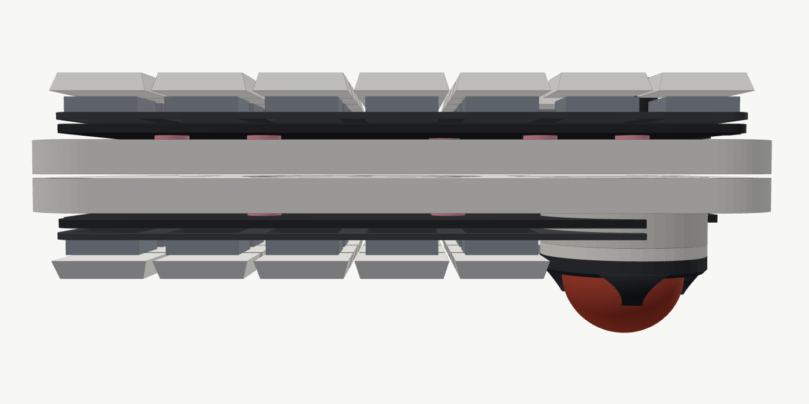

## 6. 古い版（ガスケットケース）

前の「上下ケースでプレートの耳を挟む」版のデータは `case/stl/old_gasket/`（作り直しは `case/kataware_case.py`・`case/ball_unit.py`）。
浮島ではプレートの耳を無くしたので、**古いケースには今のプレートが合わない**。参考として残している。
